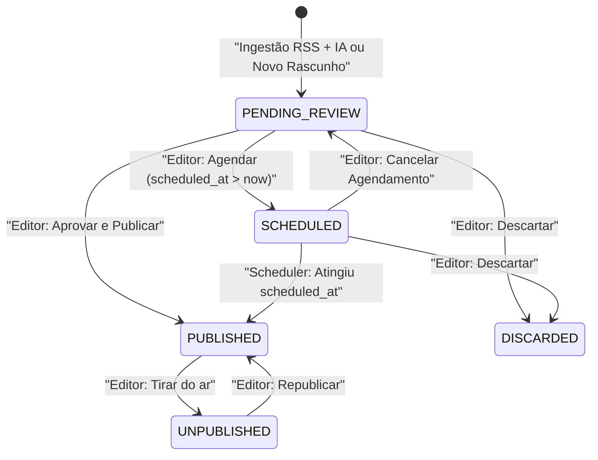
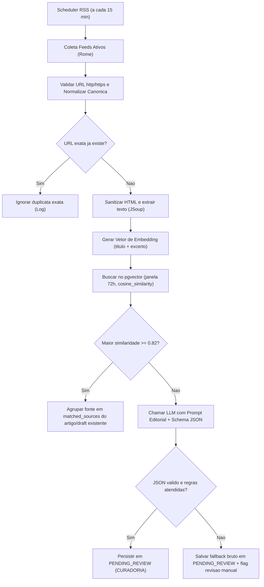

# CritHit! — Regras de Negócio, Fluxos Editoriais e Segurança

**Versão:** 1.0  
**Status:** Aprovado para Fase 1 (Produto & Documentação)  
**Referências:** [01-visao-produto.md](./01-visao-produto.md) | [02-epicos-e-historias.md](./02-epicos-e-historias.md)

---

## 1. Máquina de Estados de Artigos

Todo conteúdo editorial no CritHit! possui um estado único e rastreável na coluna `status`. A publicação automática sem revisão humana é **proibida por regra de sistema**.

### 1.1 Estados Oficiais

| Estado | Visível nas Rotas Públicas (`/`, `/reels`, `/noticia/[slug]`) | Descrição |
| :--- | :--- | :--- |
| `PENDING_REVIEW` | Não | Estado inicial obrigatório de itens gerados pelo pipeline RSS/IA ou rascunhos novos aguardando revisão humana no `/admin`. |
| `SCHEDULED` | Não | Rascunho revisado e aprovado por editor humano com `scheduled_at` futuro aguardando publicação automática pelo agendador. |
| `PUBLISHED` | Sim | Matéria ativa no ar (Home, Reels, Busca e `/noticia/[slug]`). |
| `UNPUBLISHED` | Não | Matéria retirada do ar pelo editor. Permanece preservada no banco com todo o histórico, métricas e comentários. |
| `DISCARDED` | Não | Rascunho rejeitado na triagem editorial. Permanece registrado para auditoria e para evitar reingestão repetida pelo pipeline RSS. |

### 1.2 Diagrama de Transições de Estado



### 1.3 Matriz Formal de Transições Permitidas e Proibidas

| Origem | Destino | Ator Autorizado | Pré-condições Obrigatórias | Efeitos Colaterais e Preservação |
| :--- | :--- | :--- | :--- | :--- |
| `[Inicial]` | `PENDING_REVIEW` | Worker RSS/IA ou Editor (`/admin`) | URL `source_url` válida (`http://` ou `https://`); `source_name` preenchido. | Registra `created_at`, embedding e fontes cruzadas. Nunca dispara publicação pública. |
| `PENDING_REVIEW` | `PUBLISHED` | Editor autenticado (JWT) | Atribuição completa válida (`author_name`, `content_type`, `source_name`, `source_url` `http/https`); `slug` único; título/corpo preenchidos. | Define `published_at = now()`, `reviewed_by`, `updated_at`; dispara revalidação de cache/ISR. |
| `PENDING_REVIEW` | `SCHEDULED` | Editor autenticado (JWT) | Mesmas validações de atribuição/conteúdo + `scheduled_at > now()`. | Salva `scheduled_at` e `reviewed_by`; aguarda job agendador. |
| `PENDING_REVIEW` | `DISCARDED` | Editor autenticado (JWT) | Confirmação na UI do `/admin`. | Define `discarded_at`, `reviewed_by`; mantém URL/embedding para evitar reingestão. |
| `SCHEDULED` | `PUBLISHED` | Scheduler do Backend | `now() >= scheduled_at` e revalidação de atribuição aprovada. | Define `published_at = scheduled_at` (ou `now()`); limpa estado de fila agendada; revalida cache/ISR. |
| `SCHEDULED` | `PENDING_REVIEW` | Editor autenticado (JWT) | Matéria ainda não publicada. | Limpa `scheduled_at`; retorna para fila de revisão. |
| `SCHEDULED` | `DISCARDED` | Editor autenticado (JWT) | Confirmação na UI do `/admin`. | Limpa `scheduled_at`; registra `discarded_at`. |
| `PUBLISHED` | `UNPUBLISHED` | Editor autenticado (JWT) | Confirmação na UI do `/admin`. | Define `unpublished_at = now()`, `updated_by`; **preserva integralmente** registro, `views_count`, curtidas, salvos, comentários e logs de auditoria. Se era Manchete Principal, executa regra de consistência (§ 1.4). |
| `UNPUBLISHED` | `PUBLISHED` | Editor autenticado (JWT) | Revalidação de atribuição completa e `slug` ativo. | Limpa `unpublished_at` (ou mantém histórico em log), atualiza `updated_at`/`updated_by`, reexibe nas rotas públicas preservando métricas anteriores. |

**Transições estritamente proibidas:**
- Worker RSS ou serviço de LLM transicionando diretamente para `PUBLISHED` ou `SCHEDULED`.
- Exclusão física (`DELETE`) de artigos `PUBLISHED` ou `UNPUBLISHED` pela ação "Tirar do ar" — o histórico editorial, métricas e comentários devem permanecer íntegros no PostgreSQL.
- Exposição de artigos em `PENDING_REVIEW`, `SCHEDULED`, `UNPUBLISHED` ou `DISCARDED` em qualquer endpoint público (`/api/v1/articles/**`, RSS público, sitemap, `/`, `/reels`, `/noticia/[slug]`).

### 1.4 Regra de Consistência da Manchete Principal (`is_main_headline`)

A Home (`/`) possui **exatamente uma** posição de Manchete Principal no Hero:
1. **Unicidade atômica:** No máximo 1 artigo com `status = PUBLISHED` pode ter `is_main_headline = true` simultaneamente.
2. **Promoção no `/admin`:** Quando o editor marca um artigo `PUBLISHED` como Manchete Principal (seja na aprovação ou na aba Matérias Publicadas), a transação no banco de dados executa atomicamente:
   - `UPDATE articles SET is_main_headline = false WHERE is_main_headline = true AND id <> :targetId`
   - `UPDATE articles SET is_main_headline = true WHERE id = :targetId AND status = 'PUBLISHED'`
3. **Bloqueio em estado não publicado:** Artigos em `PENDING_REVIEW`, `SCHEDULED`, `UNPUBLISHED` ou `DISCARDED` não podem permanecer com `is_main_headline = true`.
4. **Tirar do ar a Manchete Principal atual:** Quando o artigo atualmente com `is_main_headline = true` transiciona para `UNPUBLISHED`:
   - Seu campo `is_main_headline` é definido como `false` dentro da mesma transação.
   - Caso exista outro artigo `PUBLISHED` recente, o sistema promove automaticamente (ou exibe via fallback determinístico da query da capa) o artigo `PUBLISHED` mais recente para ocupar o Hero Principal, garantindo que a capa do portal **nunca** fique com o Hero vazio.

---

## 2. Pipeline de Ingestão RSS, Deduplicação Semântica e Adaptação IA

### 2.1 Visão Geral do Fluxo



### 2.2 Regras de Ingestão RSS e Limpeza (`Rome` + `JSoup`)
1. **Catálogo de fontes confiáveis:** O worker lê exclusivamente fontes cadastradas na tabela `rss_sources` com `active = true` (cobrindo fontes internacionais e nacionais nas editorias de Games, Quadrinhos & Mangás, Cinema & Séries e Tech/Hardware).
2. **Parsing seguro:** Utiliza `Rome` para leitura de feeds RSS 2.0 e Atom com timeout de conexão/leitura configurado e `User-Agent` identificável do bot editorial.
3. **Extração e sanitização (`JSoup`):** Remove tags `<script>`, `<iframe>`, `<style>`, manipuladores `on*` e rastreadores de feed; extrai texto limpo para geração de embedding e excerto de referência no split-screen do Admin.
4. **Deduplicação Nível 1 (URL Canônica):** Normaliza parâmetros de rastreamento (`utm_*`, `fbclid`, etc.) mantendo a URL original válida (`http://` ou `https://`). Se a URL normalizada (ou hash SHA-256 dela) já existir em `articles` ou `article_sources`, o item é descartado antes de gerar embeddings.

### 2.3 Normalização, Embedding e Threshold `pgvector` (`>= 0.82`)
1. **Texto de entrada do embedding:** Concatenação normalizada de `[titulo_original] + "\n" + [excerto_limpo_ate_800_chars]`, com remoção de espaços redundantes.
2. **Armazenamento vetorial:** Coluna `embedding` do tipo `vector(N)` no PostgreSQL 16 com extensão `pgvector` e índice HNSW/IVFFlat para distância cosseno (`<=>`).
3. **Janela de comparação:** Compara o novo item com registros das últimas **72 horas** (excluindo itens corrompidos; inclui `PENDING_REVIEW`, `SCHEDULED`, `PUBLISHED` e `DISCARDED` para evitar ressuscitar tema já descartado).
4. **Cálculo e Threshold:**
   - `cosine_similarity = 1 - (embedding <=> candidate_embedding)`
   - **Se `cosine_similarity >= 0.82`:** Considera-se o mesmo evento/notícia.
     - Se o registro correspondente estiver em `PENDING_REVIEW`, `SCHEDULED` ou `PUBLISHED`, o sistema anexa a nova fonte (`source_name`, `source_url`, `original_title`, `original_excerpt`, `similarity_score`, `fetched_at`) na tabela/coleção de fontes cruzadas (`matched_sources`) daquele registro, enriquecendo o painel split-screen do editor no `/admin`.
     - Se o registro correspondente estiver em `DISCARDED`, o novo item é ignorado com log de auditoria (`DISCARDED_CLUSTER_MATCH`), evitando inundar a fila com o mesmo assunto rejeitado de outro site.
   - **Se `cosine_similarity < 0.82`:** Trata-se de notícia distinta; segue para adaptação via IA.

### 2.4 Contrato Conceitual de Saída JSON do LLM

O prompt do adaptador editorial instrui o LLM a atuar segundo o **Manual de Tom de Voz Editorial** (PT-BR natural, jornalístico, zero clickbait, zero jargão robótico, fidelidade estrita aos fatos do texto de origem sem inventar datas, declarações ou números) e retornar **exclusivamente JSON válido** aderente ao contrato abaixo:

```json
{
  "headline": "Manchete direta e informativa em PT-BR (max. 110 caracteres, sem clickbait)",
  "subheadline_bullets": [
    "Ponto-chave factual 1",
    "Ponto-chave factual 2",
    "Ponto-chave factual 3"
  ],
  "lead": "Primeiro parágrafo respondendo o que, quem, quando e impacto (180 a 320 caracteres).",
  "body_paragraphs": [
    "Parágrafo de desenvolvimento com contexto técnico/editorial para o leitor brasileiro.",
    "Parágrafo complementar com detalhes confirmados pela fonte original."
  ],
  "reels_summary": "Resumo direto de 180 a 260 caracteres otimizado para leitura vertical 9:16.",
  "category": "GAMES | COMICS | CINEMA | TECH",
  "editorial_format": "NEWS | COLUMN | REVIEW",
  "tags": ["tag-1", "tag-2", "tag-3"],
  "suggested_slug": "manchete-em-kebab-case-sem-acentos",
  "reading_time_minutes": 2,
  "editorial_notes": [
    "Observação para o revisor humano (ex.: confirmar nome oficial do jogo no Brasil ou verificar trailer oficial)."
  ]
}
```

**Regras do contrato:**
- O LLM **nunca** gera nem altera `source_url`, `source_name` ou `content_type`: esses campos são injetados deterministicamente pelo backend Java a partir da fonte RSS validada (`content_type = CURADORIA`).
- A saída passa por parser estrito e validação de campos obrigatórios; qualquer resposta fora do schema aciona fallback seguro para `PENDING_REVIEW` sinalizado ao editor humano.

---

## 3. Regras de Atribuição, Segurança e Validação

### 3.1 Validação Estrita de Atribuição e Links Externos
1. **Obrigatoriedade na API e Banco:** As restrições aplicam-se tanto no DTO de entrada (`Bean Validation`) quanto nas regras de domínio antes de persistir ou transicionar para `SCHEDULED`/`PUBLISHED`:
   - `author_name`: obrigatório, trimado, comprimento entre 2 e 120 caracteres.
   - `content_type`: obrigatório, estritamente `AUTORAL` ou `CURADORIA`.
   - `source_name`: obrigatório, trimado, comprimento entre 2 e 120 caracteres.
   - `source_url`: obrigatória, comprimento máximo seguro (ex.: 2048 chars), validada por parser de URI (`java.net.URI` / `URL` + `UrlValidator`) aceitando **apenas** esquemas `http` ou `https` (case-insensitive) com `host` não vazio.
2. **Rejeição de esquemas perigosos:** Qualquer valor iniciando com `javascript:`, `data:`, `vbscript:`, `file:` ou URL sem esquema explícito é rejeitado com HTTP `400 Bad Request` (ou descartado na ingestão RSS).
3. **Proteção contra Reverse Tabnabbing no Frontend:** Todo componente que renderize `source_url` (Matéria `/noticia/[slug]`, Card de Reel `/reels`, Split-Screen `/admin`) deve validar novamente o prefixo `http://`/`https://` antes de montar o `href` e incluir obrigatoriamente:
   ```tsx
   target="_blank" rel="noopener noreferrer"
   ```

### 3.2 Segurança de Autenticação e Painel `/admin` (JWT)
1. **Endpoints protegidos:** Toda rota `/api/v1/admin/**` exige JWT válido com autoridade editorial (`ROLE_ADMIN` ou `ROLE_EDITOR`). Endpoints públicos `/api/v1/public/**` (ou `/api/v1/articles` GET público) nunca aceitam mutações editoriais nem retornam artigos não publicados.
2. **Política de Token JWT:**
   - Assinatura criptográfica forte com chave secreta injetada exclusivamente via variável de ambiente (nunca hardcoded no repositório).
   - Validação de assinatura, emissor (`iss`), expiração (`exp`) e *clock skew* reduzido.
   - Armazenamento seguro no frontend (cookie `HttpOnly; SameSite=Lax/Strict; Secure` em produção ou sessão controlada via BFF/Route Handler do Next.js para evitar exposição trivial em `localStorage` a scripts XSS).
3. **Proteção de Login:** Endpoint `/api/v1/auth/login` protegido por rate limiting (via Redis) contra força bruta e retorno genérico de erro de credenciais (`401`) sem enumerar usuários existentes.

### 3.3 Sanitização XSS e Prevenção de Clickjacking
1. **Sanitização no Backend:** Todo conteúdo textual vindo de RSS (`Rome`), saída de LLM, comentários de leitores ou edição administrativa é sanitizado via `JSoup` (`Safelist.none()` para títulos, nomes de autor, fontes, tags e comentários; `Safelist.relaxed()` ou texto puro estruturado em parágrafos para corpo de matéria).
2. **Renderização Segura no React/Next.js:** Preferência absoluta por renderização declarativa de parágrafos e listas em JSX (que realiza escape automático contra XSS). O uso de `dangerouslySetInnerHTML` é evitado; se estritamente necessário para formatação inline, exige sanitização prévia com allowlist restrita.
3. **Prevenção de Clickjacking e Hardening de Headers HTTP:**
   - `X-Frame-Options: DENY`
   - `Content-Security-Policy`: incluindo `frame-ancestors 'none'`, `object-src 'none'`, `base-uri 'self'` e restrição de scripts/fontes confiáveis.
   - `X-Content-Type-Options: nosniff`
   - `Referrer-Policy: strict-origin-when-cross-origin`
4. **Proteção contra SSRF na ingestão RSS:** O worker só busca feeds previamente cadastrados pelo administrador com protocolo `http://`/`https://`, bloqueando resolução para IPs privados/loopback (`127.0.0.1`, `10.0.0.0/8`, `169.254.169.254`, etc.) quando aplicável.
