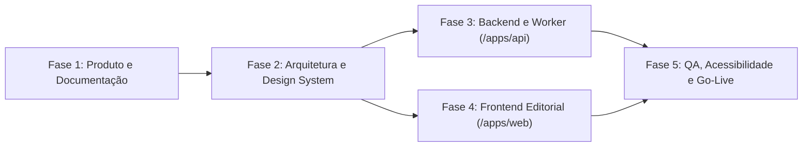

# CritHit! — Estrutura do Monorepo e Roadmap de Fases (1 a 5)

**Versão:** 1.0  
**Status:** Aprovado para Fase 1 (Produto & Documentação)  
**Referências:** [01-visao-produto.md](./01-visao-produto.md) | [02-epicos-e-historias.md](./02-epicos-e-historias.md) | [03-regras-de-negocio-e-fluxos.md](./03-regras-de-negocio-e-fluxos.md)

---

## 1. Visão Estruturada do Monorepo

O projeto **CritHit!** é organizado em um monorepo único com separação clara de responsabilidades entre documentação, API/worker Java, frontend web Next.js e infraestrutura containerizada:

```text
CritHit/
├── docs/                       # Documentação de produto, arquitetura, ADRs, API e guias de QA
│   ├── 01-visao-produto.md
│   ├── 02-epicos-e-historias.md
│   ├── 03-regras-de-negocio-e-fluxos.md
│   ├── 04-roadmap-fases.md
│   └── reference-prototype.html
├── apps/
│   ├── api/                    # Backend & Worker Editorial (Java 21 + Spring Boot 3 + Maven/Gradle)
│   │   ├── src/main/java/      # Domínio, REST APIs, Security JWT, Scheduler RSS, pgvector, LLM Adapter
│   │   ├── src/main/resources/ # application.yml + migrations Flyway (db/migration/*.sql)
│   │   └── src/test/java/      # Testes unitários (JUnit 5 + Mockito) e integração (Testcontainers)
│   └── web/                    # Portal Web & Admin (Next.js App Router + React + TypeScript + Tailwind)
│       ├── src/app/            # Rotas: /, /reels, /noticia/[slug], /admin e route handlers BFF/SEO
│       ├── src/components/     # Design System editorial (lucide-react, zero emojis, tema claro/escuro)
│       ├── src/lib/            # Clientes API, validadores de URL, helpers de SEO e tema
│       └── tests/              # Vitest + Testing Library + Playwright (@axe-core/playwright)
└── infra/                      # Infraestrutura local e observabilidade
    ├── docker-compose.yml      # PostgreSQL 16 (pgvector), Redis, API e Web
    ├── .env.example            # Variáveis de ambiente documentadas (sem segredos reais)
    └── init-db/                # Scripts de bootstrap (extensão vector, permissões)
```

---

## 2. Visão Geral das Fases de Entrega



| Fase | Foco Principal | Diretórios Impactados | Critério-Chave de Conclusão |
| :--- | :--- | :--- | :--- |
| **Fase 1** | Visão de Produto, Histórias, Regras de Negócio e Roadmap | `/docs` | Documentação completa, consistente e sem lacunas de regras |
| **Fase 2** | Arquitetura, Banco (`pgvector`), OpenAPI e Design System | `/docs`, `/infra` | ADRs, schema SQL/Flyway planejado, contrato OpenAPI e tokens UI aprovados |
| **Fase 3** | API REST, Segurança JWT, Ingestão RSS, `pgvector` e IA | `/apps/api`, `/infra` | Pipeline RSS->`PENDING_REVIEW` e CRUD `/admin` testados com Testcontainers |
| **Fase 4** | Rotas `/`, `/reels`, `/noticia/[slug]`, `/admin` e Tema | `/apps/web` | SSR/ISR funcional, zero emojis, tema claro/escuro e testes Vitest verdes |
| **Fase 5** | E2E, WCAG AA (`@axe-core/playwright`), Segurança e Deploy | `/apps/web`, `/apps/api`, `/infra` | 0 violações WCAG AA, suíte E2E aprovada e stack rodando via Docker Compose |

---

## 3. Detalhamento das Fases (Escopo, Entregáveis e Critérios de Saída)

### Fase 1 — Produto, Documentação & Histórias (Atual)
- **Escopo:** Definição da proposta de valor, personas, manual de tom de voz editorial, regras inegociáveis de atribuição jornalística, direção de arte (zero emojis, `lucide-react`, paleta 60-30-10 claro/escuro, tipografia, WCAG AA), épicos/histórias com critérios objetivos, máquina de estados, pipeline RSS/deduplicação/IA e roadmap do monorepo.
- **Entregáveis:**
  - `/docs/01-visao-produto.md`
  - `/docs/02-epicos-e-historias.md`
  - `/docs/03-regras-de-negocio-e-fluxos.md`
  - `/docs/04-roadmap-fases.md`
- **Critérios de Saída:**
  1. Todos os 4 arquivos criados em `/docs` em PT-BR e revisados quanto à consistência entre si.
  2. Cobertura integral das rotas (`/`, `/reels`, `/noticia/[slug]`, `/admin`), máquina de estados, threshold `pgvector >= 0.82`, atribuição obrigatória e requisitos de acessibilidade.

---

### Fase 2 — Arquitetura Técnica, Modelagem de Dados & Design System
- **Escopo:** Tradução dos requisitos de produto em especificações técnicas executáveis para banco relacional + vetorial, cache Redis, contratos HTTP REST/OpenAPI e especificação de tokens e componentes do Design System.
- **Entregáveis:**
  - Documentos de arquitetura em `/docs`:
    - `05-arquitetura-e-adrs.md` (decisões arquiteturais: SSR/ISR vs. API, estratégia JWT, resiliência LLM, cache Redis).
    - `06-modelo-de-dados-e-api.md` (DER, schema PostgreSQL 16 + `pgvector`, índices HNSW/GIN, contrato de endpoints públicos, Reels, newsletter e `/admin`).
    - `07-design-system-tokens.md` (mapeamento exato de cores Modo Claro `#F6F4EE`/`#FFFFFF` e Modo Escuro `#0D0F14`/`#161922`, escala tipográfica, espaçamentos, estados de foco e componentes base).
  - Setup inicial de `/infra/docker-compose.yml` (PostgreSQL 16 com `pgvector` + Redis) e `.env.example`.
- **Critérios de Saída:**
  1. Contrato OpenAPI/REST cobre 100% das ações das histórias E1–E5.
  2. Contraste de todos os pares de cores (Claro e Escuro) validado matematicamente para `>= 4.5:1` (texto normal) e `>= 3:1` (texto grande/UI).
  3. `docker compose up -d postgres redis` sobe localmente com extensão `vector` habilitada.

---

### Fase 3 — Backend & Worker Editorial (`/apps/api` + `/infra`)
- **Escopo:** Implementação da aplicação Java 21 + Spring Boot 3 contendo API pública, API administrativa protegida por JWT, camada de cache/rate-limit em Redis, migrations Flyway no PostgreSQL 16 + `pgvector`, worker agendado de coleta RSS (`Rome` + `JSoup`), serviço de embeddings e deduplicação semântica (`cosine_similarity >= 0.82`), adaptador LLM com saída JSON estruturada e agendador de publicações (`SCHEDULED` -> `PUBLISHED`).
- **Entregáveis:**
  - Projeto `/apps/api` estruturado (Domain, Application Services, Repositories, Web Controllers, Security JWT, RSS Worker, Embedding/LLM Clients).
  - Migrations Flyway em `/apps/api/src/main/resources/db/migration/` criando tabelas `articles`, `article_sources`, `rss_sources`, `article_comments`, `newsletter_subscribers`, `editorial_audit_logs`, `users` e índice `pgvector`.
  - Validações estritas de atribuição (`author_name`, `content_type`, `source_name`, `source_url` `http/https`), unicidade atômica de `is_main_headline` e preservação de histórico em `UNPUBLISHED`.
  - Suíte automatizada de testes:
    - Unitários com **JUnit 5 + Mockito** (máquina de estados, validação de URL, contrato JSON LLM, threshold `0.82`).
    - Integração com **Testcontainers** (PostgreSQL + `pgvector`, Flyway, consulta de similaridade cosseno real, endpoints JWT).
- **Critérios de Saída:**
  1. `mvn test` / `./gradlew test` passa com 100% dos testes unitários e Testcontainers verdes.
  2. Pipeline RSS executa fim-a-fim agrupando fontes com similaridade `>= 0.82` e salvando apenas em `PENDING_REVIEW`.
  3. Endpoints `/api/v1/admin/**` rejeitam requisições sem JWT válido (`401`/`403`) e bloqueiam qualquer URL fora de `http://`/`https://`.

---

### Fase 4 — Frontend Web Editorial (`/apps/web`)
- **Escopo:** Implementação do portal em Next.js App Router + React + TypeScript + Tailwind CSS + `lucide-react`, entregando as 4 rotas principais com fidelidade editorial, SSR/ISR para SEO, Modo Claro/Escuro persistente sem FOUC e integração completa com `/apps/api`.
- **Entregáveis:**
  - **Rota `/` (Home Editorial SSR/ISR):** Plantão Geek (com pausa em hover/foco e respeito a `prefers-reduced-motion`), Hero principal com sub-bullets + 3 destaques secundários, caixa lateral de Reels + Urgente na Redação, Giro Geek (2x4), Newsletter Loot Diário, Colunas & Reviews, Carrossel de Reels, 3 blocos de editorias, Mais Lidas #1–#5, Busca e Rodapé completo.
  - **Rota `/reels` e `/reels?id=<slug>`:** Feed vertical 9:16 fullscreen com `scroll-snap`, filtros por editoria, curtidas, salvos, comentários sanitizados, deep-link bidirecional, navegação por teclado (`ArrowUp`/`ArrowDown`) e preservação de scroll.
  - **Rota `/noticia/[slug]`:** Leitor completo SSR/ISR, metatags Open Graph/JSON-LD, atribuição completa (`author_name`, `content_type`, `source_name`, `source_url` com `target="_blank" rel="noopener noreferrer"`), nota de transparência em `CURADORIA`, destaques e link para `/reels?id=<slug>`.
  - **Rota `/admin`:** Login JWT, Aba Fila de Revisão (`PENDING_REVIEW` split-screen + Aprovar/Agendar/Descartar) e Aba Matérias Publicadas (`PUBLISHED`/`UNPUBLISHED` + editar qualquer campo + alternar Manchete Principal + Tirar do ar preservando histórico).
  - **Testes de componente/unidade:** Suíte **Vitest + React Testing Library** cobrindo formulários de atribuição, alternância de tema, filtros de Reels e regras de renderização segura.
- **Critérios de Saída:**
  1. Build de produção Next.js (`npm run build`) conclui sem erros de TypeScript ou lint.
  2. Suíte Vitest + Testing Library 100% aprovada.
  3. Verificação estática e visual confirma **zero emojis** na UI, piso tipográfico `>= 11px`, uso exclusivo de `lucide-react` e ausência de `user-scalable=no`.

---

### Fase 5 — QA, Acessibilidade, Segurança & Go-Live
- **Escopo:** Validação ponta a ponta do sistema integrado em containers Docker Compose, auditoria rigorosa de acessibilidade WCAG AA, testes de segurança (XSS, tabnabbing, clickjacking, autorização JWT) e preparação operacional.
- **Entregáveis:**
  - Suíte E2E **Playwright** cobrindo fluxos críticos:
    1. Leitura da Home `/`, busca e inscrição na Newsletter.
    2. Navegação `/reels`, deep-link `/reels?id=<slug>`, filtros, curtir/salvar/comentar e teclado.
    3. Leitura de `/noticia/[slug]`, validação de atribuição completa, nota de transparência e `rel="noopener noreferrer"`.
    4. Fluxo Admin `/admin`: login JWT, revisão split-screen, agendamento, publicação, troca de Manchete Principal e "Tirar do ar" (`UNPUBLISHED`) verificando retorno 404 público com histórico preservado no banco.
  - Auditoria automatizada **@axe-core/playwright** nas 4 rotas em **Modo Claro** e **Modo Escuro**.
  - Verificação automatizada de headers de segurança (`X-Frame-Options`, `Content-Security-Policy`, `X-Content-Type-Options`) e ausência de emojis/textos `< 11px`.
  - Stack completa validada via `docker compose up --build` em `/infra/docker-compose.yml`.
- **Critérios de Saída (Definition of Done Global):**
  1. **0 violações críticas ou sérias** reportadas pelo `@axe-core/playwright` (WCAG 2.1 AA) em ambos os temas.
  2. **100% dos testes E2E Playwright, Vitest e JUnit/Testcontainers passando** na mesma revisão de código.
  3. **100% das matérias publicadas** exibindo atribuição completa e links externos seguros.
  4. Documentação operacional e `.env.example` atualizados para execução reprodutível em ambiente limpo.
