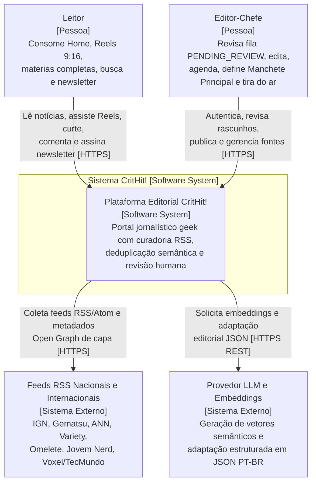
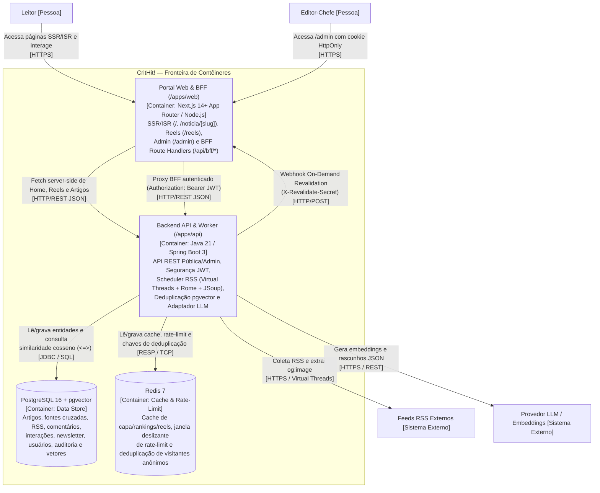

# CritHit! — Arquitetura de Software e Registros de Decisão (ADRs)

**Versão:** 1.0  
**Fase:** Fase 2 — Arquitetura Técnica  
**Referências:** [01-visao-produto.md](./01-visao-produto.md) | [02-epicos-e-historias.md](./02-epicos-e-historias.md) | [03-regras-de-negocio-e-fluxos.md](./03-regras-de-negocio-e-fluxos.md) | [04-roadmap-fases.md](./04-roadmap-fases.md) | [06-modelo-de-dados-e-api.md](./06-modelo-de-dados-e-api.md)

---

## 1. Visão Arquitetural

O **CritHit!** adota uma arquitetura modular desacoplada em monorepo, composta por um **Portal Web + BFF em Next.js (App Router)** e um **Backend Core + Worker Editorial em Java 21 / Spring Boot 3**, apoiados por **PostgreSQL 16 + `pgvector`** (persistência transacional e busca vetorial por similaridade cosseno) e **Redis 7** (cache de leitura, rate-limit e deduplicação de interações anônimas).

### Princípios Arquiteturais Inegociáveis
1. **Human-in-the-Loop Obrigatório:** Nenhum fluxo automatizado (RSS, Embedding ou LLM) possui permissão para transicionar um artigo para `PUBLISHED` ou `SCHEDULED`. Toda ingestão nasce em `PENDING_REVIEW`.
2. **Atribuição Jornalística Garantida em Múltiplas Camadas:** `author_name`, `content_type` (`AUTORAL` | `CURADORIA`), `source_name` e `source_url` (`http://` ou `https://`) são validados no frontend, na camada REST (Bean Validation), no domínio Java e em constraints `CHECK` no PostgreSQL.
3. **Separação Pública vs. Editorial:** Endpoints públicos e páginas SSR/ISR consultam exclusivamente artigos com `status = 'PUBLISHED'`. Dados em `PENDING_REVIEW`, `SCHEDULED`, `UNPUBLISHED` ou `DISCARDED` exigem sessão administrativa autenticada via JWT em cookie `HttpOnly`.
4. **Resiliência Sem Bloqueio de Fila:** Falhas de feeds externos ou do provedor LLM nunca derrubam o worker nem perdem notícias; o sistema aplica fallback determinístico seguro (`ai_status = FALLBACK_RAW`) preservando os dados brutos para revisão humana.

---

## 2. Diagramas C4 (Mermaid)

### 2.1 C4 Nível 1 — Diagrama de Contexto do Sistema

Representa os atores humanos, sistemas externos e os limites do sistema **CritHit!**.

### 2.2 C4 Nível 2 — Diagrama de Contêineres

Detalha os contêineres executáveis, armazenamento de dados, protocolos de comunicação e fronteiras de segurança.

---

## 3. Topologia de Rede, Comunicação e Fronteiras de Segurança

| Fluxo | Origem | Destino | Protocolo / Autenticação | Observações |
| :--- | :--- | :--- | :--- | :--- |
| Leitura pública e Reels | Navegador | `/apps/web` (Next.js) | HTTPS | Headers hardening (`X-Frame-Options: DENY`, `CSP`, `X-Content-Type-Options: nosniff`). |
| Fetch de dados SSR/ISR | `/apps/web` (Server) | `/apps/api` (Spring Boot) | HTTP interno REST | Rede Docker privada; `Cache-Tag` / `revalidate` controlado. |
| Mutação interativa pública | Navegador -> BFF ou API | `/apps/api` | Cookie `crithit_visitor_id` (`HttpOnly`) ou `X-Visitor-Id` | Protegido por rate-limit Redis e sanitização `JSoup`. |
| Login e ações `/admin` | Navegador | `/apps/web` BFF (`/api/bff/admin/*`) | Cookie `HttpOnly; SameSite=Lax; Secure` | O BFF extrai o JWT do cookie e injeta `Authorization: Bearer <token>` para `/apps/api`. |
| Revalidação sob demanda | `/apps/api` | `/apps/web` (`/api/revalidate`) | HTTP POST + `X-Revalidate-Secret` | Disparado após aprovação, publicação agendada, edição, troca de manchete ou `UNPUBLISHED`. |
| Ingestão RSS | `/apps/api` Worker | Feeds externos | HTTPS (Virtual Threads) | Validação anti-SSRF (bloqueio de IPs privados/loopback) e parsing com `Rome` + `JSoup`. |

---

## 4. Architecture Decision Records (ADRs)

### ADR-01 — SSR/ISR no Next.js App Router com Revalidação Sob Demanda (`revalidatePath` / `revalidateTag`)

- **Status:** Aceito  
- **Contexto:**  
  As rotas públicas principais do portal — especialmente a capa editorial (`/`) e o leitor completo (`/noticia/[slug]`) — precisam de carregamento inicial imediato para leitores mobile, indexação orgânica completa em buscadores (SEO, Open Graph, JSON-LD `NewsArticle`) e consistência imediata quando o Editor-Chefe publica, edita, altera a Manchete Principal ou tira uma matéria do ar (`UNPUBLISHED`).
- **Decisão:**  
  Utilizar **Server Components com SSR/ISR no Next.js App Router** combinados a um endpoint interno de revalidação sob demanda (`POST /api/revalidate` no `/apps/web`), acionado pelo backend Spring Boot (`/apps/api`) sempre que houver evento editorial relevante (`ARTICLE_PUBLISHED`, `ARTICLE_UPDATED`, `ARTICLE_UNPUBLISHED`, `MAIN_HEADLINE_CHANGED`).
  - As requisições `fetch` do servidor Next.js utilizam tags explícitas:
    - `home-feed` para dados agregados de `/api/v1/home` (fallback ISR `revalidate: 60`).
    - `article:<slug>` e `articles-list` para `/api/v1/articles/{slug}` (fallback ISR `revalidate: 120`).
    - `reels-feed` para `/api/v1/reels`.
  - Ao receber o webhook autenticado com `X-Revalidate-Secret`, o Route Handler executa `revalidateTag(...)` e `revalidatePath('/')` / `revalidatePath('/noticia/' + slug)` / `revalidatePath('/reels')`.
  - Caso o artigo transicione para `UNPUBLISHED`, o próximo acesso a `/noticia/[slug]` consulta a API, recebe `404` e invoca `notFound()`, removendo imediatamente a página do ar sem esperar TTL expirar.
- **Alternativas Consideradas:**
  1. **CSR (Client-Side Rendering) puro em React SPA:** Rejeitado por prejudicar SEO, metadados Open Graph dinâmicos por matéria e tempo até primeira pintura útil (LCP).
  2. **SSG puro com rebuild em cada publicação:** Rejeitado por latência alta e inviabilidade operacional para ritmo de redação de notícias e "Tirar do ar" instantâneo.
  3. **SSR puro (`cache: 'no-store'`) em todas as requisições:** Rejeitado como padrão único porque sobrecarregaria a API Java em picos de tráfego na Home sem aproveitar cache de borda/Next.js; mantido apenas onde dados dependem de sessão ou estado estritamente dinâmico.
- **Consequências:**
  - **Positivas:** Excelente performance (TTFB baixo via cache ISR), SEO completo no HTML inicial e atualização quase instantânea após ações do `/admin`.
  - **Negativas / Riscos:** Acoplamento operacional de callback entre `/apps/api` e `/apps/web`.
  - **Mitigações:** Timeout curto e execução assíncrona no disparo do webhook pela API (para não falhar a transação editorial se o front estiver reiniciando) + TTL curto de segurança (`60s`–`120s`) como rede de proteção caso um webhook falhe.

---

### ADR-02 — Autenticação JWT do `/admin` via Cookie `HttpOnly` e BFF Route Handlers no Next.js

- **Status:** Aceito  
- **Contexto:**  
  O painel `/admin` controla operações sensíveis (aprovação de pautas, edição, troca de Manchete Principal, remoção de matérias do ar e cadastro de feeds RSS). Armazenar JWT em `localStorage` ou `sessionStorage` expõe a credencial a qualquer script injetado (XSS) caso ocorra alguma vulnerabilidade de terceiros. Por outro lado, o backend Spring Boot é uma API REST stateless baseada em JWT.
- **Decisão:**  
  Implementar padrão **BFF (Backend-for-Frontend)** nos Route Handlers do Next.js (`/api/bff/auth/*` e `/api/bff/admin/*`) atuando como mediador entre o navegador e o Spring Boot:
  1. **Login (`POST /api/bff/auth/login`):** O Next.js encaminha as credenciais para `POST /api/v1/admin/auth/login` na API Java. Ao receber `accessToken` e `refreshToken` (ou `token` + expiração), o BFF **não** devolve o JWT ao JavaScript do cliente; grava-o em cookie seguro:
     - `crithit_admin_token`: `HttpOnly; Path=/; SameSite=Lax` (e `Secure` quando `NODE_ENV=production` / HTTPS).
  2. **Chamadas Autenticadas (`/api/bff/admin/**`):** Os Route Handlers ou Server Components leem o cookie `HttpOnly`, anexam `Authorization: Bearer <jwt>` e encaminham a chamada para `/apps/api/api/v1/admin/**`.
  3. **Proteção CSRF:** Uso de `SameSite=Lax` no cookie combinado com validação de cabeçalho `Origin` / `Referer` no BFF para métodos mutáveis (`POST`, `PUT`, `PATCH`, `DELETE`) e suporte opcional a token CSRF double-submit se necessário em fluxos multi-origem.
  4. **Renovação e Logout:**
     - Se o access token estiver próximo da expiração (ou receber `401` com `refresh_token` válido em cookie `HttpOnly` dedicado `crithit_admin_refresh`), o BFF renova de forma transparente ou invalida os cookies redirecionando para o login.
     - `POST /api/bff/auth/logout` chama `POST /api/v1/admin/auth/logout` (que registra `jti` na blacklist do Redis até o `exp` original) e limpa os cookies com `Max-Age=0`.
- **Alternativas Consideradas:**
  1. **JWT em `localStorage` enviado diretamente pelo cliente:** Rejeitado por exposição direta a XSS e impossibilidade de leitura segura em Server Components SSR do Next.js.
  2. **Sessão statefull tradicional no Spring Session:** Rejeitado para manter o backend `/apps/api` stateless, compatível com Bearer JWT padrão para testes automatizados e clientes CLI/integração.
- **Consequências:**
  - **Positivas:** Token inacessível via `document.cookie` / XSS no navegador; proteção natural nas rotas Server Components `/admin`; revogação imediata no logout via Redis.
  - **Negativas / Riscos:** Camada adicional de proxy no `/apps/web` para rotas admin.
  - **Mitigações:** Proxy genérico tipado e enxuto em `/apps/web/src/app/api/bff/admin/[...path]/route.ts` preservando status codes HTTP e payloads de erro estruturados da API.

---

### ADR-03 — Virtual Threads (Java 21) no Worker de Coleta e Parsing RSS (`Rome` + `JSoup`)

- **Status:** Aceito  
- **Contexto:**  
  O pipeline editorial coleta periodicamente dezenas de feeds RSS/Atom (nacionais e internacionais) e, quando o feed não inclui imagem de capa em `media:content` ou `enclosure`, realiza fetch da página de origem para extrair `og:image`/`twitter:image` via `JSoup`. Esse fluxo é altamente **I/O-bound** (espera de rede HTTP, DNS, TLS), onde pools tradicionais de threads de plataforma (`FixedThreadPool`) desperdiçam memória ou saturam rapidamente quando um portal parceiro fica lento.
- **Decisão:**  
  Executar os jobs de coleta RSS no Java 21 utilizando **Virtual Threads** (`Executors.newVirtualThreadPerTaskExecutor()` ou `spring.threads.virtual.enabled=true` com executor dedicado para o pipeline RSS), isolando falhas e limitando concorrência externa:
  1. **Concorrência Controlada (Bulkhead):** Cada ciclo de coleta dispara uma Virtual Thread por fonte RSS ativa, controlada por um **`Semaphore` de concorrência global** (ex.: máximo de `12` fetches HTTP simultâneos) e **rate-limit por domínio** para não sobrecarregar portais parceiros.
  2. **Timeouts Rígidos:** `HttpClient` Java 21 configurado com `connectTimeout = 5s` e `requestTimeout = 10s` por feed/página, além de limite máximo de payload (`5 MB`) para evitar exaustão de memória.
  3. **Circuit Breaker por Fonte RSS:** Falhas consecutivas (ex.: 5 erros `5xx` ou timeouts seguidos em uma `rss_source`) abrem circuito temporário naquela fonte (cooldown exponencial registrado em `consecutive_failures` / `last_error_at` na tabela `rss_sources` e estado em Redis), impedindo que um site fora do ar atrase o ciclo das demais fontes.
  4. **Segurança na Coleta:** Uso de `Rome` para parsing RSS/Atom + `JSoup` com `Safelist.none()` para texto puro + validação anti-SSRF resolvendo o host antes da conexão para bloquear endereços loopback, link-local (`169.254.0.0/16`) e faixas privadas RFC 1918.
- **Alternativas Consideradas:**
  1. **WebFlux / Netty reativo:** Rejeitado por aumentar significativamente a complexidade cognitiva do código quando integrado a JDBC/Flyway/pgvector bloqueantes e bibliotecas síncronas como `Rome`.
  2. **ThreadPool tradicional (`ThreadPoolExecutor` com threads de SO):** Rejeitado por menor eficiência em alto volume de esperas de rede I/O e maior consumo de memória de stack por thread.
- **Consequências:**
  - **Positivas:** Código imperativo simples, legível e depurável com alta escalabilidade para I/O HTTP concorrente; isolamento de falhas por fonte.
  - **Negativas / Riscos:** Risco de *thread pinning* se houver blocos `synchronized` longos envolvendo operações de I/O.
  - **Mitigações:** Uso exclusivo de `ReentrantLock` / `Semaphore` (`java.util.concurrent`) ao invés de `synchronized` ao redor de chamadas de rede ou JDBC; pool HikariCP dimensionado separadamente para conexões reais do PostgreSQL.

---

### ADR-04 — Resiliência e Fallback Seguro em Falhas do Provedor LLM

- **Status:** Aceito  
- **Contexto:**  
  Provedores externos de LLM e embeddings estão sujeitos a limites de taxa (`429 Too Many Requests`), indisponibilidades (`5xx`), latência elevada (timeouts) ou respostas malformadas (JSON truncado, markdown envolvendo JSON ou violação de campos obrigatórios). O pipeline RSS não pode perder notícias relevantes nem travar o agendamento por causa de instabilidade do LLM, e tampouco pode publicar automaticamente conteúdo sem revisão.
- **Decisão:**  
  Implementar cadeia determinística de resiliência no `LlmAdaptationService`:
  1. **Retry com Exponential Backoff + Jitter:** Para erros transitórios (`429`, `502`, `503`, `504`, timeout), executar até **3 tentativas** (ex.: `1s`, `3s`, `7s` + jitter) com timeout por chamada de `25s`. Erros `400`/`401`/`403` não sofrem retry cego e disparam alerta operacional imediato.
  2. **Validação Estrita do Schema JSON:** A resposta do LLM passa por parser Jackson estrito validando presença e limites de `headline`, `subheadline_bullets` (1 a 3 itens), `lead`, `body_paragraphs`, `reels_summary`, `category`, `editorial_format` e `suggested_slug`, além de sanitização `JSoup` em todos os campos textuais.
  3. **Fallback Determinístico Seguro (`FALLBACK_RAW`):** Se todas as tentativas falharem ou o JSON permanecer inválido:
     - O sistema **não** descarta a notícia e **não** bloqueia o restante da fila RSS.
     - O artigo é persistido obrigatoriamente em `status = 'PENDING_REVIEW'` com `ai_status = 'FALLBACK_RAW'` e `content_type = 'CURADORIA'`.
     - Os campos de origem (`raw_title`, `raw_excerpt`, `source_name`, `source_url`) são preservados integralmente; os campos editoriais recebem preenchimento seguro provisório baseado no texto sanitizado (`headline` derivada de `raw_title`, `lead` derivada de `raw_excerpt`, `editorial_notes` informando falha da IA e necessidade de redação/revisão manual).
     - Se a falha ocorrer no serviço de **embeddings** antes da deduplicação semântica, o item também pode seguir para `PENDING_REVIEW` com `ai_status = 'FALLBACK_RAW'` e `embedding = NULL` (sinalizado para revisão humana) ou entrar em fila de reprocessamento de embedding sem duplicar URL canônica.
- **Alternativas Consideradas:**
  1. **Descartar o item quando o LLM falha:** Rejeitado pois causaria perda silenciosa de furos jornalísticos durante instabilidades de API.
  2. **Manter em fila de retry infinita sem visibilidade no Admin:** Rejeitado porque atrasaria notícias urgentes (Plantão Geek) que o editor pode adaptar manualmente em 2 minutos no split-screen.
- **Consequências:**
  - **Positivas:** Continuidade operacional garantida; visibilidade imediata no painel `/admin` com badge `FALLBACK_RAW` indicando que a IA falhou; zero risco de conteúdo corrompido ir ao ar.
  - **Negativas / Riscos:** Eventual acúmulo de rascunhos em inglês na fila `PENDING_REVIEW` durante queda prolongada do LLM.
  - **Mitigações:** Filtro por `ai_status` na aba Fila de Revisão do `/admin` e comando/job administrativo opcional para re-executar adaptação IA em itens `FALLBACK_RAW` ainda em `PENDING_REVIEW`.

---

### ADR-05 — Estratégia de Cache, Invalidação Editorial e Rate-Limit no Redis

- **Status:** Aceito  
- **Contexto:**  
  A Home (`/api/v1/home`), o feed de Reels (`/api/v1/reels`) e o ranking "Mais Lidas da Semana" concentram a maior parte das leituras públicas e executam múltiplas agregações/ordenações no PostgreSQL. Paralelamente, os endpoints públicos interativos (comentários, curtidas, visualizações e inscrição na newsletter) e o login administrativo precisam de proteção contra abuso, spam e força bruta sem exigir conta de usuário para o leitor comum.
- **Decisão:**  
  Adotar o **Redis 7** para três responsabilidades bem delimitadas com prefixos de chave padronizados (`crithit:*`):
  1. **Cache de Leitura Pública (Cache-Aside + Invalidação por Evento):**
     - `crithit:cache:home:v1` (TTL `60s`): payload consolidado da Home (Hero, 3 secundários, Urgente, Plantão, Giro Geek, Colunas & Reviews, carrossel Reels, 3 editorias, Mais Lidas).
     - `crithit:cache:reels:page:<category>:<cursor>` (TTL `60s`): listagens de Reels por editoria.
     - `crithit:cache:article:<slug>` (TTL `120s`): DTO público completo da matéria (somente `PUBLISHED`).
     - **Invalidação ativa:** Toda mutação editorial no `/admin` ou publicação agendada (`PUBLISHED`, `UPDATED`, `UNPUBLISHED`, `MAIN_HEADLINE_CHANGED`) limpa as chaves afetadas imediatamente via `DEL` / `SCAN` controlado por prefixo antes de disparar o webhook de revalidação ISR do Next.js.
  2. **Rate-Limiting em Janela Deslizante (Sliding Window via ZSET / Lua Script):**
     - `POST /api/v1/admin/auth/login`: máx. `5` tentativas / `5 min` por IP (`429 Too Many Requests`).
     - `POST /api/v1/articles/{id}/comments`: máx. `5` comentários / `10 min` por `visitor_hash` + IP.
     - `POST /api/v1/newsletter/subscribe`: máx. `5` requisições / `15 min` por IP.
     - `POST /api/v1/articles/{id}/like` e `POST /api/v1/articles/{id}/view`: máx. `30` req / `1 min` por visitante/IP.
     - `GET /api/v1/articles` (busca `q=`): máx. `60` req / `1 min` por IP para proteger consultas `ILIKE`/`pg_trgm`.
  3. **Deduplicação de Interações Anônimas e Revogação JWT:**
     - `crithit:view:<articleId>:<visitorHash>` (`SET ... EX 21600 NX`): garante no máximo 1 incremento real de `views_count` por visitante/artigo a cada **6 horas**.
     - `crithit:jwt:blacklist:<jti>` (TTL = tempo restante até `exp`): invalidação instantânea no logout administrativo.
- **Alternativas Consideradas:**
  1. **Cache apenas em memória da JVM (Caffeine):** Rejeitado para rate-limit e blacklist JWT por não ser compartilhável caso a API escale para múltiplas réplicas e por perder estado em restarts.
  2. **Rate-limit apenas no banco relacional:** Rejeitado por adicionar pressão de escrita desnecessária ao PostgreSQL sob picos ou ataques de spam.
- **Consequências:**
  - **Positivas:** Resposta sub-10ms para leituras em cache, proteção robusta contra brute-force e spam de comentários/views, e invalidabilidade coordenada com o ISR do Next.js.
  - **Negativas / Riscos:** Dependência de disponibilidade do Redis para rate-limit e cache.
  - **Mitigações:** Degradação graciosa configurada no Spring Cache/Redis para endpoints de **leitura** (`GET`) — se o Redis ficar temporariamente indisponível, a consulta cai direto no PostgreSQL com log de alerta; para login admin e comentários, aplica fallback conservador em memória local para manter proteção básica.
