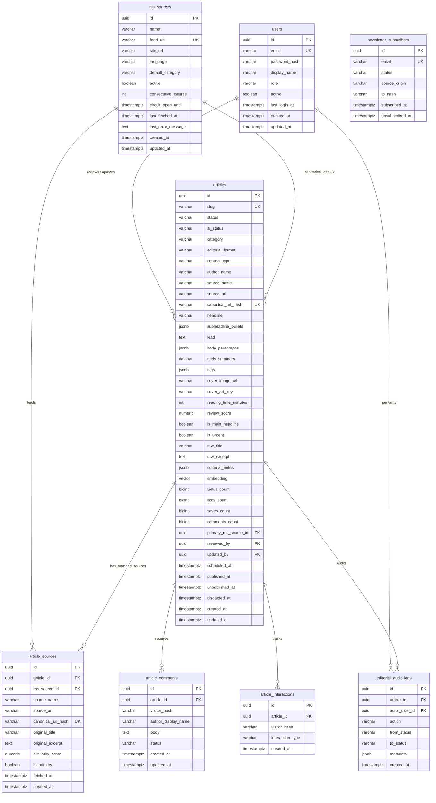

# CritHit! — Modelo de Dados, DDL (`pgvector`) e Especificação OpenAPI 3.1

**Versão:** 1.0  
**Fase:** Fase 2 — Arquitetura Técnica  
**Referências:** [01-visao-produto.md](./01-visao-produto.md) | [02-epicos-e-historias.md](./02-epicos-e-historias.md) | [03-regras-de-negocio-e-fluxos.md](./03-regras-de-negocio-e-fluxos.md) | [05-arquitetura-e-adrs.md](./05-arquitetura-e-adrs.md)

---

## 1. Diagrama Entidade-Relacionamento (DER)



---

## 2. DDL Completo PostgreSQL 16 + `pgvector`

O DDL abaixo é compatível com **PostgreSQL 16** e serve como base direta para a migration inicial Flyway (`V1__init_schema.sql`) e para testes com Testcontainers na Fase 3.

> **Nota sobre dimensão vetorial:** A coluna `articles.embedding` utiliza `vector(1536)` por padrão (compatível com modelos de 1536 dimensões como `text-embedding-3-small`). Caso seja adotado modelo com outra dimensionalidade na Fase 3, basta ajustar o parâmetro de dimensão na migration inicial antes do Go-Live.

```sql
-- ============================================================================
-- CritHit! — Schema Relacional e Vetorial (PostgreSQL 16 + pgvector)
-- ============================================================================

CREATE EXTENSION IF NOT EXISTS vector;
CREATE EXTENSION IF NOT EXISTS pgcrypto;
CREATE EXTENSION IF NOT EXISTS pg_trgm;

-- ----------------------------------------------------------------------------
-- 1. Usuários Editoriais (/admin)
-- ----------------------------------------------------------------------------
CREATE TABLE users (
    id              UUID PRIMARY KEY DEFAULT gen_random_uuid(),
    email           VARCHAR(160) NOT NULL,
    password_hash   VARCHAR(255) NOT NULL,
    display_name    VARCHAR(120) NOT NULL,
    role            VARCHAR(30)  NOT NULL DEFAULT 'ROLE_EDITOR',
    active          BOOLEAN      NOT NULL DEFAULT TRUE,
    last_login_at   TIMESTAMPTZ,
    created_at      TIMESTAMPTZ  NOT NULL DEFAULT NOW(),
    updated_at      TIMESTAMPTZ  NOT NULL DEFAULT NOW(),

    CONSTRAINT uq_users_email UNIQUE (email),
    CONSTRAINT chk_users_role CHECK (role IN ('ROLE_ADMIN', 'ROLE_EDITOR')),
    CONSTRAINT chk_users_display_name_len CHECK (char_length(btrim(display_name)) >= 2)
);

-- ----------------------------------------------------------------------------
-- 2. Fontes RSS Monitoradas
-- ----------------------------------------------------------------------------
CREATE TABLE rss_sources (
    id                   UUID PRIMARY KEY DEFAULT gen_random_uuid(),
    name                 VARCHAR(120) NOT NULL,
    feed_url             VARCHAR(2048) NOT NULL,
    site_url             VARCHAR(2048) NOT NULL,
    language             VARCHAR(10)  NOT NULL DEFAULT 'en',
    default_category     VARCHAR(20)  NOT NULL,
    active               BOOLEAN      NOT NULL DEFAULT TRUE,
    consecutive_failures INTEGER      NOT NULL DEFAULT 0,
    circuit_open_until   TIMESTAMPTZ,
    last_fetched_at      TIMESTAMPTZ,
    last_error_message   TEXT,
    created_at           TIMESTAMPTZ  NOT NULL DEFAULT NOW(),
    updated_at           TIMESTAMPTZ  NOT NULL DEFAULT NOW(),

    CONSTRAINT uq_rss_sources_feed_url UNIQUE (feed_url),
    CONSTRAINT chk_rss_sources_feed_url_proto CHECK (feed_url ~* '^https?://[^[:space:]]+'),
    CONSTRAINT chk_rss_sources_site_url_proto CHECK (site_url ~* '^https?://[^[:space:]]+'),
    CONSTRAINT chk_rss_sources_lang CHECK (language IN ('pt-BR', 'en', 'es', 'ja')),
    CONSTRAINT chk_rss_sources_category CHECK (default_category IN ('GAMES', 'COMICS', 'CINEMA', 'ANIMES', 'TECH')),
    CONSTRAINT chk_rss_sources_failures_nonneg CHECK (consecutive_failures >= 0)
);

CREATE INDEX idx_rss_sources_active ON rss_sources (active) WHERE active = TRUE;

-- ----------------------------------------------------------------------------
-- 3. Artigos / Matérias (Núcleo Editorial + Vetor pgvector)
-- ----------------------------------------------------------------------------
CREATE TABLE articles (
    id                    UUID PRIMARY KEY DEFAULT gen_random_uuid(),
    slug                  VARCHAR(180) NOT NULL,
    status                VARCHAR(20)  NOT NULL DEFAULT 'PENDING_REVIEW',
    ai_status             VARCHAR(20)  NOT NULL DEFAULT 'SUCCESS',
    category              VARCHAR(20)  NOT NULL,
    editorial_format      VARCHAR(20)  NOT NULL DEFAULT 'NEWS',

    -- Regras Inegociáveis de Atribuição Jornalística
    content_type          VARCHAR(20)  NOT NULL,
    author_name           VARCHAR(120) NOT NULL,
    source_name           VARCHAR(120) NOT NULL,
    source_url            VARCHAR(2048) NOT NULL,
    canonical_url_hash    CHAR(64),

    -- Conteúdo Editorial Estruturado
    headline              VARCHAR(180) NOT NULL,
    subheadline_bullets   JSONB        NOT NULL DEFAULT '[]'::jsonb,
    lead                  TEXT         NOT NULL,
    body_paragraphs       JSONB        NOT NULL DEFAULT '[]'::jsonb,
    reels_summary         VARCHAR(320) NOT NULL,
    tags                  JSONB        NOT NULL DEFAULT '[]'::jsonb,

    -- Mídia e Fallback Visual
    cover_image_url       VARCHAR(2048),
    cover_art_key         VARCHAR(60)  NOT NULL DEFAULT 'editorial-games-default',

    -- Metadados e Destaque
    reading_time_minutes  INTEGER      NOT NULL DEFAULT 2,
    review_score          NUMERIC(3,1),
    is_main_headline      BOOLEAN      NOT NULL DEFAULT FALSE,
    is_urgent             BOOLEAN      NOT NULL DEFAULT FALSE,

    -- Dados Brutos de Origem (Split-Screen / Fallback LLM)
    raw_title             VARCHAR(300),
    raw_excerpt           TEXT,
    editorial_notes       JSONB        NOT NULL DEFAULT '[]'::jsonb,

    -- Vetor Semântico para Deduplicação (cosine_similarity >= 0.82)
    embedding             vector(1536),

    -- Contadores Preservados Mesmo em UNPUBLISHED
    views_count           BIGINT       NOT NULL DEFAULT 0,
    likes_count           BIGINT       NOT NULL DEFAULT 0,
    saves_count           BIGINT       NOT NULL DEFAULT 0,
    comments_count        BIGINT       NOT NULL DEFAULT 0,

    -- Rastreabilidade Editorial
    primary_rss_source_id UUID         REFERENCES rss_sources(id) ON DELETE SET NULL,
    reviewed_by           UUID         REFERENCES users(id) ON DELETE SET NULL,
    updated_by            UUID         REFERENCES users(id) ON DELETE SET NULL,
    scheduled_at          TIMESTAMPTZ,
    published_at          TIMESTAMPTZ,
    unpublished_at        TIMESTAMPTZ,
    discarded_at          TIMESTAMPTZ,
    created_at            TIMESTAMPTZ  NOT NULL DEFAULT NOW(),
    updated_at            TIMESTAMPTZ  NOT NULL DEFAULT NOW(),

    CONSTRAINT uq_articles_slug UNIQUE (slug),
    CONSTRAINT uq_articles_canonical_url_hash UNIQUE (canonical_url_hash),
    CONSTRAINT chk_articles_status CHECK (
        status IN ('PENDING_REVIEW', 'SCHEDULED', 'PUBLISHED', 'UNPUBLISHED', 'DISCARDED')
    ),
    CONSTRAINT chk_articles_ai_status CHECK (
        ai_status IN ('SUCCESS', 'FALLBACK_RAW', 'MANUAL')
    ),
    CONSTRAINT chk_articles_category CHECK (
        category IN ('GAMES', 'COMICS', 'CINEMA', 'ANIMES', 'TECH')
    ),
    CONSTRAINT chk_articles_format CHECK (
        editorial_format IN ('NEWS', 'COLUMN', 'REVIEW')
    ),
    CONSTRAINT chk_articles_content_type CHECK (
        content_type IN ('AUTORAL', 'CURADORIA')
    ),
    CONSTRAINT chk_articles_author_name_len CHECK (char_length(btrim(author_name)) >= 2),
    CONSTRAINT chk_articles_source_name_len CHECK (char_length(btrim(source_name)) >= 2),
    CONSTRAINT chk_articles_source_url_proto CHECK (source_url ~* '^https?://[^[:space:]]+'),
    CONSTRAINT chk_articles_cover_url_proto CHECK (
        cover_image_url IS NULL OR cover_image_url ~* '^https?://[^[:space:]]+'
    ),
    CONSTRAINT chk_articles_reading_time_pos CHECK (reading_time_minutes >= 1 AND reading_time_minutes <= 60),
    CONSTRAINT chk_articles_review_score_range CHECK (
        review_score IS NULL OR (review_score >= 0.0 AND review_score <= 10.0)
    ),
    CONSTRAINT chk_articles_main_headline_only_published CHECK (
        is_main_headline = FALSE OR status = 'PUBLISHED'
    ),
    CONSTRAINT chk_articles_counts_nonneg CHECK (
        views_count >= 0 AND likes_count >= 0 AND saves_count >= 0 AND comments_count >= 0
    )
);

-- Unicidade transacional garantida no banco: no máximo 1 Manchete Principal PUBLISHED
CREATE UNIQUE INDEX uq_articles_single_main_headline
    ON articles (is_main_headline)
    WHERE status = 'PUBLISHED' AND is_main_headline = TRUE;

-- Índices para consultas da capa, Reels, scheduler e busca editorial
CREATE INDEX idx_articles_published_feed
    ON articles (published_at DESC, created_at DESC)
    WHERE status = 'PUBLISHED';

CREATE INDEX idx_articles_published_category
    ON articles (category, published_at DESC)
    WHERE status = 'PUBLISHED';

CREATE INDEX idx_articles_most_read_7d
    ON articles (views_count DESC, published_at DESC)
    WHERE status = 'PUBLISHED';

CREATE INDEX idx_articles_pending_review
    ON articles (created_at DESC)
    WHERE status = 'PENDING_REVIEW';

CREATE INDEX idx_articles_scheduled_due
    ON articles (scheduled_at ASC)
    WHERE status = 'SCHEDULED';

CREATE INDEX idx_articles_dedup_window
    ON articles (created_at DESC, status)
    WHERE embedding IS NOT NULL AND status IN ('PENDING_REVIEW', 'SCHEDULED', 'PUBLISHED', 'DISCARDED');

-- Índice trigram para busca textual rápida (GET /api/v1/articles?q=...)
CREATE INDEX idx_articles_headline_trgm
    ON articles USING GIN (headline gin_trgm_ops);

-- Índice HNSW pgvector para busca aproximada por distância cosseno (<=>)
-- Nota: cosine_similarity = 1 - (embedding <=> candidate) >= 0.82  <=>  (embedding <=> candidate) <= 0.18
CREATE INDEX idx_articles_embedding_hnsw
    ON articles USING hnsw (embedding vector_cosine_ops)
    WITH (m = 16, ef_construction = 64);

-- ----------------------------------------------------------------------------
-- 4. Fontes Cruzadas / Agrupamento Semântico (matched_sources)
-- ----------------------------------------------------------------------------
CREATE TABLE article_sources (
    id                  UUID PRIMARY KEY DEFAULT gen_random_uuid(),
    article_id          UUID         NOT NULL REFERENCES articles(id) ON DELETE CASCADE,
    rss_source_id       UUID         REFERENCES rss_sources(id) ON DELETE SET NULL,
    source_name         VARCHAR(120) NOT NULL,
    source_url          VARCHAR(2048) NOT NULL,
    canonical_url_hash  CHAR(64)     NOT NULL,
    original_title      VARCHAR(300) NOT NULL,
    original_excerpt    TEXT,
    similarity_score    NUMERIC(5,4) NOT NULL DEFAULT 1.0000,
    is_primary          BOOLEAN      NOT NULL DEFAULT FALSE,
    fetched_at          TIMESTAMPTZ  NOT NULL DEFAULT NOW(),
    created_at          TIMESTAMPTZ  NOT NULL DEFAULT NOW(),

    CONSTRAINT uq_article_sources_url_hash UNIQUE (canonical_url_hash),
    CONSTRAINT chk_article_sources_url_proto CHECK (source_url ~* '^https?://[^[:space:]]+'),
    CONSTRAINT chk_article_sources_similarity_range CHECK (
        similarity_score >= 0.0000 AND similarity_score <= 1.0000
    )
);

CREATE INDEX idx_article_sources_article_id ON article_sources (article_id, fetched_at DESC);

-- ----------------------------------------------------------------------------
-- 5. Comentários de Leitores
-- ----------------------------------------------------------------------------
CREATE TABLE article_comments (
    id                  UUID PRIMARY KEY DEFAULT gen_random_uuid(),
    article_id          UUID        NOT NULL REFERENCES articles(id) ON DELETE CASCADE,
    visitor_hash        CHAR(64)    NOT NULL,
    author_display_name VARCHAR(60) NOT NULL,
    body                TEXT        NOT NULL,
    status              VARCHAR(20) NOT NULL DEFAULT 'VISIBLE',
    created_at          TIMESTAMPTZ NOT NULL DEFAULT NOW(),
    updated_at          TIMESTAMPTZ NOT NULL DEFAULT NOW(),

    CONSTRAINT chk_article_comments_author_len CHECK (char_length(btrim(author_display_name)) >= 2),
    CONSTRAINT chk_article_comments_body_len CHECK (
        char_length(btrim(body)) >= 3 AND char_length(body) <= 1000
    ),
    CONSTRAINT chk_article_comments_status CHECK (status IN ('VISIBLE', 'HIDDEN'))
);

CREATE INDEX idx_article_comments_article_visible
    ON article_comments (article_id, created_at DESC)
    WHERE status = 'VISIBLE';

-- ----------------------------------------------------------------------------
-- 6. Interações Anônimas (Views / Likes / Saves)
-- ----------------------------------------------------------------------------
CREATE TABLE article_interactions (
    id                UUID PRIMARY KEY DEFAULT gen_random_uuid(),
    article_id        UUID        NOT NULL REFERENCES articles(id) ON DELETE CASCADE,
    visitor_hash      CHAR(64)    NOT NULL,
    interaction_type  VARCHAR(10) NOT NULL,
    created_at        TIMESTAMPTZ NOT NULL DEFAULT NOW(),

    CONSTRAINT chk_article_interactions_type CHECK (interaction_type IN ('VIEW', 'LIKE', 'SAVE'))
);

-- Para LIKE e SAVE, cada visitante anônimo possui no máximo 1 registro ativo (toggle atômico)
CREATE UNIQUE INDEX uq_article_interactions_toggle
    ON article_interactions (article_id, visitor_hash, interaction_type)
    WHERE interaction_type IN ('LIKE', 'SAVE');

CREATE INDEX idx_article_interactions_views_lookup
    ON article_interactions (article_id, visitor_hash, created_at DESC)
    WHERE interaction_type = 'VIEW';

-- ----------------------------------------------------------------------------
-- 7. Assinantes da Newsletter ("Loot Diário")
-- ----------------------------------------------------------------------------
CREATE TABLE newsletter_subscribers (
    id               UUID PRIMARY KEY DEFAULT gen_random_uuid(),
    email            VARCHAR(180) NOT NULL,
    status           VARCHAR(20)  NOT NULL DEFAULT 'ACTIVE',
    source_origin    VARCHAR(60)  NOT NULL DEFAULT 'HOME_LOOT_DIARIO',
    ip_hash          CHAR(64),
    subscribed_at    TIMESTAMPTZ  NOT NULL DEFAULT NOW(),
    unsubscribed_at  TIMESTAMPTZ,

    CONSTRAINT uq_newsletter_email UNIQUE (email),
    CONSTRAINT chk_newsletter_status CHECK (status IN ('ACTIVE', 'UNSUBSCRIBED'))
);

-- ----------------------------------------------------------------------------
-- 8. Auditoria Editorial
-- ----------------------------------------------------------------------------
CREATE TABLE editorial_audit_logs (
    id             UUID PRIMARY KEY DEFAULT gen_random_uuid(),
    article_id     UUID        NOT NULL REFERENCES articles(id) ON DELETE CASCADE,
    actor_user_id  UUID        REFERENCES users(id) ON DELETE SET NULL,
    action         VARCHAR(40) NOT NULL,
    from_status    VARCHAR(20),
    to_status      VARCHAR(20),
    metadata       JSONB       NOT NULL DEFAULT '{}'::jsonb,
    created_at     TIMESTAMPTZ NOT NULL DEFAULT NOW(),

    CONSTRAINT chk_audit_action CHECK (
        action IN (
            'INGESTED_RSS',
            'INGESTED_FALLBACK_RAW',
            'MATCHED_SOURCE_ADDED',
            'CREATED_MANUAL',
            'EDITED',
            'APPROVED_PUBLISHED',
            'SCHEDULED',
            'AUTO_PUBLISHED_BY_SCHEDULER',
            'DISCARDED',
            'UNPUBLISHED',
            'REPUBLISHED',
            'SET_MAIN_HEADLINE',
            'UNSET_MAIN_HEADLINE'
        )
    )
);

CREATE INDEX idx_editorial_audit_article ON editorial_audit_logs (article_id, created_at DESC);
```

### 2.1 Consulta Canônica de Deduplicação Semântica (`pgvector >= 0.82`)

```sql
-- Executada antes da chamada ao LLM para cada item RSS novo com embedding gerado.
-- Janela de comparação: últimas 72 horas em status relevantes (inclui DISCARDED).
SELECT
    a.id,
    a.status,
    a.headline,
    (1 - (a.embedding <=> :candidateEmbedding)) AS similarity_score
FROM articles a
WHERE a.embedding IS NOT NULL
  AND a.created_at >= NOW() - INTERVAL '72 hours'
  AND a.status IN ('PENDING_REVIEW', 'SCHEDULED', 'PUBLISHED', 'DISCARDED')
  AND (1 - (a.embedding <=> :candidateEmbedding)) >= 0.82
ORDER BY a.embedding <=> :candidateEmbedding ASC
LIMIT 1;
```

### 2.2 Script de Seed Inicial (`V2__seed_rss_sources.sql`)

```sql
-- ============================================================================
-- Seed Inicial de Feeds RSS Reais (Internacionais e Nacionais) + Admin Base
-- ============================================================================

INSERT INTO rss_sources (name, feed_url, site_url, language, default_category, active)
VALUES
    -- Internacionais (Games, Anime/Mangá, Cinema/Séries, Tech)
    ('IGN', 'https://feeds.feedburner.com/ign/all', 'https://www.ign.com', 'en', 'GAMES', TRUE),
    ('Gematsu', 'https://www.gematsu.com/feed', 'https://www.gematsu.com', 'en', 'GAMES', TRUE),
    ('Eurogamer', 'https://www.eurogamer.net/feed', 'https://www.eurogamer.net', 'en', 'GAMES', TRUE),
    ('Anime News Network', 'https://www.animenewsnetwork.com/all/rss.xml', 'https://www.animenewsnetwork.com', 'en', 'ANIMES', TRUE),
    ('Variety', 'https://variety.com/feed/', 'https://variety.com', 'en', 'CINEMA', TRUE),
    ('Bleeding Cool', 'https://bleedingcool.com/feed/', 'https://bleedingcool.com', 'en', 'COMICS', TRUE),

    -- Nacionais (PT-BR)
    ('Omelete', 'https://www.omelete.com.br/rss', 'https://www.omelete.com.br', 'pt-BR', 'CINEMA', TRUE),
    ('Jovem Nerd', 'https://jovemnerd.com.br/feed/', 'https://jovemnerd.com.br', 'pt-BR', 'GAMES', TRUE),
    ('Voxel / TecMundo', 'https://rss.tecmundo.com.br/feed', 'https://www.tecmundo.com.br/voxel', 'pt-BR', 'TECH', TRUE)
ON CONFLICT (feed_url) DO NOTHING;

-- Nota de Segurança: O usuário administrativo inicial deve ser semeado via
-- ApplicationRunner na inicialização da Fase 3 lendo ADMIN_SEED_EMAIL e
-- ADMIN_SEED_PASSWORD do ambiente e aplicando BCryptPasswordEncoder (sem senha
-- hardcoded no repositório SQL).
```

---

## 3. Regra de Extração, Validação e Fallback de `cover_image_url`

Para garantir capas ricas sem URLs inseguras ou imagens quebradas (`404`/hotlink bloqueado), o pipeline de ingestão (`CoverImageExtractor`) aplica a seguinte ordem determinística:

1. **Ordem de Extração no Feed / Página:**
   1. Elemento RSS `media:content` (com `medium="image"` ou MIME `image/*`) ou `media:thumbnail` (maior resolução disponível).
   2. Elemento RSS `enclosure` cujo `type` inicie com `image/`.
   3. Metatags HTML da página de origem (`source_url`) buscadas via `JSoup` com timeout `5s` e proteção anti-SSRF:
      - `<meta property="og:image" content="...">`
      - `<meta name="twitter:image" content="...">`
      - `<meta name="twitter:image:src" content="...">`
2. **Validação Estrita de Segurança e Formato:**
   - URL absoluta obrigatória com esquema `http://` ou `https://` (rejeitar `data:`, `javascript:`, `blob:`, URLs relativas não resolvíveis ou hosts privados/loopback).
   - Extensão ou `Content-Type` seguro permitido: `.jpg`, `.jpeg`, `.png`, `.webp`, `.avif` (`image/jpeg`, `image/png`, `image/webp`, `image/avif`). URLs de SVG remoto (`.svg` / `image/svg+xml`) ou placeholders conhecidos (ex.: `1x1` pixel de tracking) são descartadas para evitar XSS via SVG externo.
3. **Fallback Determinístico Local (`cover_art_key`):**
   - Caso nenhuma imagem válida seja encontrada ou a validação falhe, `cover_image_url` é gravada como `NULL` e `cover_art_key` recebe deterministicamente a arte da editoria:
     - `GAMES` -> `editorial-games-default`
     - `COMICS` -> `editorial-comics-default`
     - `CINEMA` -> `editorial-cinema-default`
     - `ANIMES` -> `editorial-animes-default`
     - `TECH` -> `editorial-tech-default`
   - No frontend (`/apps/web`), quando `cover_image_url` for `NULL` (ou disparar `onError` no cliente), o componente `<EditorialCover />` renderiza localmente um **SVG editorial temático vetorial** correspondente a `cover_art_key` (com textura sutil de meio-tom e paleta da editoria), garantindo layout íntegro em cards 16:9 e Reels 9:16.

---

## 4. Estratégia de Interações Anônimas (`views`, `likes`, `saves`, `comentários`)

O leitor do **CritHit!** não precisa criar conta para ler, curtir, salvar ou comentar. A rastreabilidade sem fricção funciona da seguinte forma:

1. **Identificação do Visitante Anônimo (`visitor_hash`):**
   - Na primeira interação ou acesso via BFF/API, se o cliente não enviar o cookie `HttpOnly` `crithit_visitor_id` (UUID v4), o servidor gera um novo UUID v4 e devolve `Set-Cookie: crithit_visitor_id=<uuid>; HttpOnly; SameSite=Lax; Path=/; Max-Age=31536000` (`Secure` em produção).
   - Para chamadas diretas de API/testes automatizados sem cookies, aceita-se também o header opcional `X-Visitor-Id` (UUID válido).
   - O backend nunca armazena o IP puro nem o cookie bruto na tabela de interações: calcula `visitor_hash = SHA-256(visitor_id + ":" + salt_ou_ua_parcial)` (64 caracteres hex).
2. **Visualizações (`POST /api/v1/articles/{id}/view`):**
   - Chave Redis: `crithit:view:{articleId}:{visitorHash}` com `SET ... EX 21600 NX` (**6 horas**).
   - Somente quando a chave não existia no Redis é que o backend insere evento `VIEW` em `article_interactions` e executa `UPDATE articles SET views_count = views_count + 1 WHERE id = :id AND status = 'PUBLISHED'`.
3. **Curtidas (`POST /api/v1/articles/{id}/like`):**
   - Rate-limit Redis: `30` req/min por `visitor_hash`/IP.
   - Operação transacional idempotente de **toggle**:
     - Tenta `DELETE FROM article_interactions WHERE article_id = :id AND visitor_hash = :hash AND interaction_type = 'LIKE'`.
     - Se deletou 1 linha -> decrementa `likes_count` (piso `0`) e retorna `{ liked: false, likesCount }`.
     - Se deletou 0 linhas -> insere `LIKE` e incrementa `likes_count` atomicamente, retornando `{ liked: true, likesCount }`.
4. **Salvos (`POST /api/v1/articles/{id}/save` + `localStorage`):**
   - O frontend mantém lista local de slugs salvos em `localStorage` para resposta instantânea na barra lateral dos Reels e lista "Salvos" do navegador, e sincroniza o toggle via `POST /api/v1/articles/{id}/save` para contabilizar `saves_count` preservado no banco.
5. **Comentários (`GET` e `POST /api/v1/articles/{id}/comments`):**
   - Apenas artigos `PUBLISHED` aceitam e exibem comentários (`status = 'VISIBLE'`).
   - `authorDisplayName` (2..60 chars) e `body` (3..1000 chars) são sanitizados no backend com `JSoup.clean(input, Safelist.none())` — rejeitando comentários que fiquem vazios após remoção de HTML.
   - Protegido por rate-limit em janela deslizante no Redis: máximo `5` comentários a cada `10 minutos` por `visitor_hash` + IP.

---

## 5. Especificação OpenAPI 3.1

```yaml
openapi: 3.1.0
info:
  title: CritHit! Editorial API
  version: 1.0.0
  description: >
    API REST oficial do portal de jornalismo geek CritHit!, cobrindo rotas públicas
    (Home, Artigos, Reels, Interações Anônimas, Newsletter e Health) e rotas
    administrativas protegidas por JWT (Auth, Fila PENDING_REVIEW, Publicação,
    Agendamento, Manchete Principal, Tirar do Ar e Fontes RSS).
servers:
  - url: http://localhost:8080
    description: API Spring Boot Local

tags:
  - name: Public - Feed & Articles
  - name: Public - Interactions
  - name: Public - Newsletter & Health
  - name: Admin - Auth
  - name: Admin - Editorial Workflow
  - name: Admin - RSS Sources

paths:
  /api/v1/health:
    get:
      tags: [Public - Newsletter & Health]
      summary: Verifica saúde da API, PostgreSQL e Redis
      responses:
        "200":
          description: Serviço operacional
          content:
            application/json:
              schema:
                $ref: "#/components/schemas/HealthResponse"

  /api/v1/home:
    get:
      tags: [Public - Feed & Articles]
      summary: Payload consolidado da capa editorial (/)
      description: >
        Retorna exclusivamente matérias PUBLISHED organizadas para a Home:
        mainHeadline (com fallback determinístico), secondaryHeadlines (até 3),
        breakingTicker, urgentNews (até 2), giroGeek (até 8), columnsAndReviews (até 4),
        featuredReels (até 6), categoryBlocks (GAMES, COMICS, CINEMA) e mostRead (top 5).
      responses:
        "200":
          description: Estrutura completa da capa editorial
          content:
            application/json:
              schema:
                $ref: "#/components/schemas/HomeResponse"

  /api/v1/articles:
    get:
      tags: [Public - Feed & Articles]
      summary: Lista e busca matérias publicadas (PUBLISHED)
      parameters:
        - name: q
          in: query
          description: Termo de busca textual (manchete, lead ou tags)
          schema:
            type: string
            maxLength: 100
        - name: category
          in: query
          schema:
            $ref: "#/components/schemas/Category"
        - name: format
          in: query
          schema:
            $ref: "#/components/schemas/EditorialFormat"
        - name: page
          in: query
          schema:
            type: integer
            minimum: 0
            default: 0
        - name: size
          in: query
          schema:
            type: integer
            minimum: 1
            maximum: 50
            default: 12
      responses:
        "200":
          description: Página de artigos publicados
          content:
            application/json:
              schema:
                $ref: "#/components/schemas/PublicArticlePage"

  /api/v1/articles/{slug}:
    get:
      tags: [Public - Feed & Articles]
      summary: Obtém matéria completa publicada por slug
      description: Retorna 404 para qualquer status diferente de PUBLISHED.
      parameters:
        - name: slug
          in: path
          required: true
          schema:
            type: string
      responses:
        "200":
          description: Detalhes completos da matéria com atribuição e relacionados
          content:
            application/json:
              schema:
                $ref: "#/components/schemas/PublicArticleDetail"
        "404":
          $ref: "#/components/responses/NotFound"

  /api/v1/reels:
    get:
      tags: [Public - Feed & Articles]
      summary: Lista feed vertical de Reels (PUBLISHED)
      parameters:
        - name: category
          in: query
          schema:
            $ref: "#/components/schemas/Category"
        - name: focusSlug
          in: query
          description: Slug inicial solicitado via deep-link (/reels?id=<slug>)
          schema:
            type: string
        - name: page
          in: query
          schema:
            type: integer
            minimum: 0
            default: 0
        - name: size
          in: query
          schema:
            type: integer
            minimum: 1
            maximum: 30
            default: 15
      responses:
        "200":
          description: Lista paginada de cards de Reels 9:16
          content:
            application/json:
              schema:
                $ref: "#/components/schemas/ReelsFeedResponse"

  /api/v1/articles/{id}/view:
    post:
      tags: [Public - Interactions]
      summary: Registra visualização única anônima (janela Redis de 6h)
      parameters:
        - $ref: "#/components/parameters/ArticleIdPath"
        - $ref: "#/components/parameters/VisitorIdHeader"
      responses:
        "200":
          description: Contagem de visualizações atualizada ou deduplicada
          content:
            application/json:
              schema:
                $ref: "#/components/schemas/ViewResponse"
        "404":
          $ref: "#/components/responses/NotFound"
        "429":
          $ref: "#/components/responses/TooManyRequests"

  /api/v1/articles/{id}/like:
    post:
      tags: [Public - Interactions]
      summary: Alterna curtida anônima (toggle atômico sem login)
      parameters:
        - $ref: "#/components/parameters/ArticleIdPath"
        - $ref: "#/components/parameters/VisitorIdHeader"
      responses:
        "200":
          description: Estado atual da curtida e contador atualizado
          content:
            application/json:
              schema:
                $ref: "#/components/schemas/LikeToggleResponse"
        "404":
          $ref: "#/components/responses/NotFound"
        "429":
          $ref: "#/components/responses/TooManyRequests"

  /api/v1/articles/{id}/save:
    post:
      tags: [Public - Interactions]
      summary: Alterna salvamento anônimo (toggle contador + sessão anônima)
      parameters:
        - $ref: "#/components/parameters/ArticleIdPath"
        - $ref: "#/components/parameters/VisitorIdHeader"
      responses:
        "200":
          description: Estado atual de salvo e contador atualizado
          content:
            application/json:
              schema:
                $ref: "#/components/schemas/SaveToggleResponse"
        "404":
          $ref: "#/components/responses/NotFound"
        "429":
          $ref: "#/components/responses/TooManyRequests"

  /api/v1/articles/{id}/comments:
    get:
      tags: [Public - Interactions]
      summary: Lista comentários visíveis da matéria publicada
      parameters:
        - $ref: "#/components/parameters/ArticleIdPath"
        - name: page
          in: query
          schema:
            type: integer
            minimum: 0
            default: 0
        - name: size
          in: query
          schema:
            type: integer
            minimum: 1
            maximum: 50
            default: 20
      responses:
        "200":
          description: Lista paginada de comentários sanitizados
          content:
            application/json:
              schema:
                $ref: "#/components/schemas/CommentPage"
        "404":
          $ref: "#/components/responses/NotFound"
    post:
      tags: [Public - Interactions]
      summary: Publica comentário sanitizado contra XSS (com rate-limit Redis)
      parameters:
        - $ref: "#/components/parameters/ArticleIdPath"
        - $ref: "#/components/parameters/VisitorIdHeader"
      requestBody:
        required: true
        content:
          application/json:
            schema:
              $ref: "#/components/schemas/CreateCommentRequest"
      responses:
        "201":
          description: Comentário criado e sanitizado
          content:
            application/json:
              schema:
                $ref: "#/components/schemas/CommentDto"
        "400":
          $ref: "#/components/responses/BadRequest"
        "404":
          $ref: "#/components/responses/NotFound"
        "429":
          $ref: "#/components/responses/TooManyRequests"

  /api/v1/newsletter/subscribe:
    post:
      tags: [Public - Newsletter & Health]
      summary: Inscreve e-mail na newsletter "Loot Diário"
      requestBody:
        required: true
        content:
          application/json:
            schema:
              $ref: "#/components/schemas/NewsletterSubscribeRequest"
      responses:
        "201":
          description: Inscrição confirmada (ou reativada de forma idempotente)
          content:
            application/json:
              schema:
                $ref: "#/components/schemas/NewsletterSubscribeResponse"
        "400":
          $ref: "#/components/responses/BadRequest"
        "429":
          $ref: "#/components/responses/TooManyRequests"

  /api/v1/admin/auth/login:
    post:
      tags: [Admin - Auth]
      summary: Autentica editor/admin e emite JWT (consumido pelo BFF HttpOnly)
      requestBody:
        required: true
        content:
          application/json:
            schema:
              $ref: "#/components/schemas/LoginRequest"
      responses:
        "200":
          description: Autenticação bem-sucedida
          content:
            application/json:
              schema:
                $ref: "#/components/schemas/AuthTokenResponse"
        "401":
          $ref: "#/components/responses/Unauthorized"
        "429":
          $ref: "#/components/responses/TooManyRequests"

  /api/v1/admin/auth/logout:
    post:
      tags: [Admin - Auth]
      summary: Revoga JWT atual na blacklist Redis
      security:
        - BearerJwt: []
      responses:
        "204":
          description: Sessão encerrada e token revogado
        "401":
          $ref: "#/components/responses/Unauthorized"

  /api/v1/admin/auth/refresh:
    post:
      tags: [Admin - Auth]
      summary: Renova accessToken a partir de refreshToken válido
      requestBody:
        required: true
        content:
          application/json:
            schema:
              $ref: "#/components/schemas/RefreshTokenRequest"
      responses:
        "200":
          description: Novo par de tokens emitido
          content:
            application/json:
              schema:
                $ref: "#/components/schemas/AuthTokenResponse"
        "401":
          $ref: "#/components/responses/Unauthorized"

  /api/v1/admin/auth/me:
    get:
      tags: [Admin - Auth]
      summary: Retorna perfil do editor autenticado
      security:
        - BearerJwt: []
      responses:
        "200":
          description: Dados do usuário editorial
          content:
            application/json:
              schema:
                $ref: "#/components/schemas/AdminUserDto"
        "401":
          $ref: "#/components/responses/Unauthorized"

  /api/v1/admin/articles:
    get:
      tags: [Admin - Editorial Workflow]
      summary: Lista artigos da redação por status (PENDING_REVIEW, SCHEDULED, PUBLISHED, UNPUBLISHED, DISCARDED)
      security:
        - BearerJwt: []
      parameters:
        - name: status
          in: query
          schema:
            $ref: "#/components/schemas/ArticleStatus"
        - name: aiStatus
          in: query
          schema:
            $ref: "#/components/schemas/AiStatus"
        - name: category
          in: query
          schema:
            $ref: "#/components/schemas/Category"
        - name: q
          in: query
          schema:
            type: string
        - name: page
          in: query
          schema:
            type: integer
            default: 0
        - name: size
          in: query
          schema:
            type: integer
            default: 20
      responses:
        "200":
          description: Lista paginada de artigos do painel editorial
          content:
            application/json:
              schema:
                $ref: "#/components/schemas/AdminArticlePage"
        "401":
          $ref: "#/components/responses/Unauthorized"
        "403":
          $ref: "#/components/responses/Forbidden"
    post:
      tags: [Admin - Editorial Workflow]
      summary: Cria novo rascunho editorial manual (inicia em PENDING_REVIEW)
      security:
        - BearerJwt: []
      requestBody:
        required: true
        content:
          application/json:
            schema:
              $ref: "#/components/schemas/AdminArticleUpsertRequest"
      responses:
        "201":
          description: Rascunho criado em PENDING_REVIEW
          content:
            application/json:
              schema:
                $ref: "#/components/schemas/AdminArticleDetail"
        "400":
          $ref: "#/components/responses/BadRequest"
        "401":
          $ref: "#/components/responses/Unauthorized"

  /api/v1/admin/articles/{id}:
    get:
      tags: [Admin - Editorial Workflow]
      summary: Obtém detalhes completos para split-screen (inclui raw_title, raw_excerpt e matched_sources)
      security:
        - BearerJwt: []
      parameters:
        - $ref: "#/components/parameters/ArticleIdPath"
      responses:
        "200":
          description: Dados completos do artigo para revisão/edição
          content:
            application/json:
              schema:
                $ref: "#/components/schemas/AdminArticleDetail"
        "401":
          $ref: "#/components/responses/Unauthorized"
        "404":
          $ref: "#/components/responses/NotFound"
    put:
      tags: [Admin - Editorial Workflow]
      summary: Atualiza qualquer campo editorial ou de atribuição (preservando status atual)
      security:
        - BearerJwt: []
      parameters:
        - $ref: "#/components/parameters/ArticleIdPath"
      requestBody:
        required: true
        content:
          application/json:
            schema:
              $ref: "#/components/schemas/AdminArticleUpsertRequest"
      responses:
        "200":
          description: Artigo atualizado com registro em editorial_audit_logs
          content:
            application/json:
              schema:
                $ref: "#/components/schemas/AdminArticleDetail"
        "400":
          $ref: "#/components/responses/BadRequest"
        "401":
          $ref: "#/components/responses/Unauthorized"
        "404":
          $ref: "#/components/responses/NotFound"

  /api/v1/admin/articles/{id}/approve:
    post:
      tags: [Admin - Editorial Workflow]
      summary: Aprova e publica imediatamente (PENDING_REVIEW -> PUBLISHED)
      description: Permite enviar edições finais opcionais junto à aprovação; valida atribuição obrigatória.
      security:
        - BearerJwt: []
      parameters:
        - $ref: "#/components/parameters/ArticleIdPath"
      requestBody:
        required: false
        content:
          application/json:
            schema:
              $ref: "#/components/schemas/AdminApproveRequest"
      responses:
        "200":
          description: Artigo publicado e cache/ISR revalidados
          content:
            application/json:
              schema:
                $ref: "#/components/schemas/AdminArticleDetail"
        "400":
          $ref: "#/components/responses/BadRequest"
        "409":
          $ref: "#/components/responses/Conflict"

  /api/v1/admin/articles/{id}/schedule:
    post:
      tags: [Admin - Editorial Workflow]
      summary: Agenda publicação futura (PENDING_REVIEW -> SCHEDULED)
      security:
        - BearerJwt: []
      parameters:
        - $ref: "#/components/parameters/ArticleIdPath"
      requestBody:
        required: true
        content:
          application/json:
            schema:
              $ref: "#/components/schemas/ScheduleArticleRequest"
      responses:
        "200":
          description: Artigo agendado
          content:
            application/json:
              schema:
                $ref: "#/components/schemas/AdminArticleDetail"
        "400":
          $ref: "#/components/responses/BadRequest"
        "409":
          $ref: "#/components/responses/Conflict"

  /api/v1/admin/articles/{id}/discard:
    post:
      tags: [Admin - Editorial Workflow]
      summary: Descarta rascunho da fila (PENDING_REVIEW/SCHEDULED -> DISCARDED)
      security:
        - BearerJwt: []
      parameters:
        - $ref: "#/components/parameters/ArticleIdPath"
      requestBody:
        required: false
        content:
          application/json:
            schema:
              $ref: "#/components/schemas/ReasonRequest"
      responses:
        "200":
          description: Artigo marcado como DISCARDED mantendo registro para deduplicação
          content:
            application/json:
              schema:
                $ref: "#/components/schemas/AdminArticleDetail"
        "409":
          $ref: "#/components/responses/Conflict"

  /api/v1/admin/articles/{id}/unpublish:
    post:
      tags: [Admin - Editorial Workflow]
      summary: Tira matéria do ar preservando histórico, métricas e comentários (PUBLISHED -> UNPUBLISHED)
      security:
        - BearerJwt: []
      parameters:
        - $ref: "#/components/parameters/ArticleIdPath"
      requestBody:
        required: false
        content:
          application/json:
            schema:
              $ref: "#/components/schemas/ReasonRequest"
      responses:
        "200":
          description: Artigo retirado do ar (404 nas rotas públicas) com dados preservados
          content:
            application/json:
              schema:
                $ref: "#/components/schemas/AdminArticleDetail"
        "409":
          $ref: "#/components/responses/Conflict"

  /api/v1/admin/articles/{id}/republish:
    post:
      tags: [Admin - Editorial Workflow]
      summary: Republica matéria previamente retirada do ar (UNPUBLISHED -> PUBLISHED)
      security:
        - BearerJwt: []
      parameters:
        - $ref: "#/components/parameters/ArticleIdPath"
      responses:
        "200":
          description: Artigo republicado preservando métricas anteriores
          content:
            application/json:
              schema:
                $ref: "#/components/schemas/AdminArticleDetail"
        "400":
          $ref: "#/components/responses/BadRequest"
        "409":
          $ref: "#/components/responses/Conflict"

  /api/v1/admin/articles/{id}/main-headline:
    post:
      tags: [Admin - Editorial Workflow]
      summary: Promove matéria PUBLISHED como Manchete Principal única da Home (transação atômica)
      security:
        - BearerJwt: []
      parameters:
        - $ref: "#/components/parameters/ArticleIdPath"
      responses:
        "200":
          description: Manchete Principal atualizada atomicamente
          content:
            application/json:
              schema:
                $ref: "#/components/schemas/AdminArticleDetail"
        "409":
          $ref: "#/components/responses/Conflict"

  /api/v1/admin/rss-sources:
    get:
      tags: [Admin - RSS Sources]
      summary: Lista fontes RSS cadastradas e status do circuit breaker
      security:
        - BearerJwt: []
      responses:
        "200":
          description: Catálogo de fontes RSS
          content:
            application/json:
              schema:
                type: array
                items:
                  $ref: "#/components/schemas/RssSourceDto"
    post:
      tags: [Admin - RSS Sources]
      summary: Cadastra nova fonte RSS validada (http/https)
      security:
        - BearerJwt: []
      requestBody:
        required: true
        content:
          application/json:
            schema:
              $ref: "#/components/schemas/CreateRssSourceRequest"
      responses:
        "201":
          description: Fonte RSS cadastrada
          content:
            application/json:
              schema:
                $ref: "#/components/schemas/RssSourceDto"
        "400":
          $ref: "#/components/responses/BadRequest"

  /api/v1/admin/rss-sources/{id}:
    patch:
      tags: [Admin - RSS Sources]
      summary: Ativa/desativa ou atualiza metadados de uma fonte RSS
      security:
        - BearerJwt: []
      parameters:
        - name: id
          in: path
          required: true
          schema:
            type: string
            format: uuid
      requestBody:
        required: true
        content:
          application/json:
            schema:
              $ref: "#/components/schemas/UpdateRssSourceRequest"
      responses:
        "200":
          description: Fonte RSS atualizada
          content:
            application/json:
              schema:
                $ref: "#/components/schemas/RssSourceDto"
        "404":
          $ref: "#/components/responses/NotFound"

  /api/v1/admin/rss-sources/trigger:
    post:
      tags: [Admin - RSS Sources]
      summary: Dispara ciclo manual imediato de ingestão RSS (Virtual Threads)
      security:
        - BearerJwt: []
      parameters:
        - name: sourceId
          in: query
          required: false
          description: Se informado, coleta apenas a fonte específica; caso contrário, todas as ativas.
          schema:
            type: string
            format: uuid
      responses:
        "202":
          description: Coleta iniciada em segundo plano
          content:
            application/json:
              schema:
                $ref: "#/components/schemas/RssTriggerResponse"

components:
  securitySchemes:
    BearerJwt:
      type: http
      scheme: bearer
      bearerFormat: JWT

  parameters:
    ArticleIdPath:
      name: id
      in: path
      required: true
      schema:
        type: string
        format: uuid
    VisitorIdHeader:
      name: X-Visitor-Id
      in: header
      required: false
      description: UUID v4 opcional (quando não enviado, utiliza cookie HttpOnly crithit_visitor_id)
      schema:
        type: string
        format: uuid

  responses:
    BadRequest:
      description: Erro de validação ou regra de negócio
      content:
        application/json:
          schema:
            $ref: "#/components/schemas/ApiError"
    Unauthorized:
      description: Não autenticado ou JWT inválido/expirado
      content:
        application/json:
          schema:
            $ref: "#/components/schemas/ApiError"
    Forbidden:
      description: Sem permissão editorial
      content:
        application/json:
          schema:
            $ref: "#/components/schemas/ApiError"
    NotFound:
      description: Recurso não encontrado ou não publicado
      content:
        application/json:
          schema:
            $ref: "#/components/schemas/ApiError"
    Conflict:
      description: Transição de estado inválida ou conflito de unicidade
      content:
        application/json:
          schema:
            $ref: "#/components/schemas/ApiError"
    TooManyRequests:
      description: Limite de taxa excedido (Redis sliding-window)
      content:
        application/json:
          schema:
            $ref: "#/components/schemas/ApiError"

  schemas:
    ArticleStatus:
      type: string
      enum: [PENDING_REVIEW, SCHEDULED, PUBLISHED, UNPUBLISHED, DISCARDED]
    AiStatus:
      type: string
      enum: [SUCCESS, FALLBACK_RAW, MANUAL]
    Category:
      type: string
      enum: [GAMES, COMICS, CINEMA, ANIMES, TECH]
    EditorialFormat:
      type: string
      enum: [NEWS, COLUMN, REVIEW]
    ContentType:
      type: string
      enum: [AUTORAL, CURADORIA]

    ApiError:
      type: object
      required: [timestamp, status, error, message, path]
      properties:
        timestamp:
          type: string
          format: date-time
        status:
          type: integer
        error:
          type: string
        message:
          type: string
        path:
          type: string
        fieldErrors:
          type: array
          items:
            type: object
            properties:
              field:
                type: string
              message:
                type: string

    HealthResponse:
      type: object
      required: [status, database, redis, timestamp]
      properties:
        status:
          type: string
          enum: [UP, DEGRADED]
        database:
          type: string
        redis:
          type: string
        timestamp:
          type: string
          format: date-time

    AttributionInfo:
      type: object
      required: [authorName, contentType, sourceName, sourceUrl]
      properties:
        authorName:
          type: string
          minLength: 2
          maxLength: 120
        contentType:
          $ref: "#/components/schemas/ContentType"
        sourceName:
          type: string
          minLength: 2
          maxLength: 120
        sourceUrl:
          type: string
          format: uri
          pattern: "^https?://.+"

    MatchedSourceDto:
      type: object
      required: [id, sourceName, sourceUrl, originalTitle, similarityScore, isPrimary, fetchedAt]
      properties:
        id:
          type: string
          format: uuid
        sourceName:
          type: string
        sourceUrl:
          type: string
          format: uri
          pattern: "^https?://.+"
        originalTitle:
          type: string
        originalExcerpt:
          type: [string, "null"]
        similarityScore:
          type: number
          minimum: 0
          maximum: 1
        isPrimary:
          type: boolean
        fetchedAt:
          type: string
          format: date-time

    PublicArticleSummary:
      type: object
      required:
        [id, slug, category, editorialFormat, headline, lead, subheadlineBullets,
         reelsSummary, coverArtKey, readingTimeMinutes, isMainHeadline, isUrgent,
         viewsCount, likesCount, savesCount, commentsCount, publishedAt, attribution]
      properties:
        id:
          type: string
          format: uuid
        slug:
          type: string
        category:
          $ref: "#/components/schemas/Category"
        editorialFormat:
          $ref: "#/components/schemas/EditorialFormat"
        headline:
          type: string
        subheadlineBullets:
          type: array
          items:
            type: string
        lead:
          type: string
        reelsSummary:
          type: string
        tags:
          type: array
          items:
            type: string
        coverImageUrl:
          type: [string, "null"]
          format: uri
        coverArtKey:
          type: string
        readingTimeMinutes:
          type: integer
        reviewScore:
          type: [number, "null"]
        isMainHeadline:
          type: boolean
        isUrgent:
          type: boolean
        viewsCount:
          type: integer
        likesCount:
          type: integer
        savesCount:
          type: integer
        commentsCount:
          type: integer
        publishedAt:
          type: string
          format: date-time
        attribution:
          $ref: "#/components/schemas/AttributionInfo"

    PublicArticleDetail:
      allOf:
        - $ref: "#/components/schemas/PublicArticleSummary"
        - type: object
          required: [bodyParagraphs, matchedSources, relatedArticles, viewerState]
          properties:
            bodyParagraphs:
              type: array
              items:
                type: string
            matchedSources:
              type: array
              items:
                $ref: "#/components/schemas/MatchedSourceDto"
            relatedArticles:
              type: array
              items:
                $ref: "#/components/schemas/PublicArticleSummary"
            viewerState:
              type: object
              properties:
                liked:
                  type: boolean
                saved:
                  type: boolean

    HomeResponse:
      type: object
      required:
        [breakingTicker, mainHeadline, secondaryHeadlines, urgentNews,
         giroGeek, columnsAndReviews, featuredReels, categoryBlocks, mostRead, generatedAt]
      properties:
        breakingTicker:
          type: array
          items:
            type: object
            properties:
              slug:
                type: string
              headline:
                type: string
              category:
                $ref: "#/components/schemas/Category"
              publishedAt:
                type: string
                format: date-time
        mainHeadline:
          oneOf:
            - $ref: "#/components/schemas/PublicArticleSummary"
            - type: "null"
        secondaryHeadlines:
          type: array
          maxItems: 3
          items:
            $ref: "#/components/schemas/PublicArticleSummary"
        urgentNews:
          type: array
          maxItems: 2
          items:
            $ref: "#/components/schemas/PublicArticleSummary"
        giroGeek:
          type: array
          maxItems: 8
          items:
            $ref: "#/components/schemas/PublicArticleSummary"
        columnsAndReviews:
          type: array
          maxItems: 4
          items:
            $ref: "#/components/schemas/PublicArticleSummary"
        featuredReels:
          type: array
          maxItems: 6
          items:
            $ref: "#/components/schemas/PublicArticleSummary"
        categoryBlocks:
          type: object
          properties:
            GAMES:
              type: array
              items:
                $ref: "#/components/schemas/PublicArticleSummary"
            COMICS:
              type: array
              items:
                $ref: "#/components/schemas/PublicArticleSummary"
            CINEMA:
              type: array
              items:
                $ref: "#/components/schemas/PublicArticleSummary"
            ANIMES:
              type: array
              items:
                $ref: "#/components/schemas/PublicArticleSummary"
            TECH:
              type: array
              items:
                $ref: "#/components/schemas/PublicArticleSummary"
        mostRead:
          type: array
          maxItems: 5
          items:
            $ref: "#/components/schemas/PublicArticleSummary"
        generatedAt:
          type: string
          format: date-time

    PublicArticlePage:
      type: object
      required: [content, page, size, totalElements, totalPages]
      properties:
        content:
          type: array
          items:
            $ref: "#/components/schemas/PublicArticleSummary"
        page:
          type: integer
        size:
          type: integer
        totalElements:
          type: integer
        totalPages:
          type: integer

    ReelsFeedResponse:
      type: object
      required: [items, page, size, totalElements, hasNext, focusSlugFound]
      properties:
        items:
          type: array
          items:
            $ref: "#/components/schemas/PublicArticleSummary"
        page:
          type: integer
        size:
          type: integer
        totalElements:
          type: integer
        hasNext:
          type: boolean
        focusSlugFound:
          type: boolean

    ViewResponse:
      type: object
      required: [articleId, viewsCount, counted]
      properties:
        articleId:
          type: string
          format: uuid
        viewsCount:
          type: integer
        counted:
          type: boolean

    LikeToggleResponse:
      type: object
      required: [articleId, liked, likesCount]
      properties:
        articleId:
          type: string
          format: uuid
        liked:
          type: boolean
        likesCount:
          type: integer

    SaveToggleResponse:
      type: object
      required: [articleId, saved, savesCount]
      properties:
        articleId:
          type: string
          format: uuid
        saved:
          type: boolean
        savesCount:
          type: integer

    CommentDto:
      type: object
      required: [id, articleId, authorDisplayName, body, createdAt]
      properties:
        id:
          type: string
          format: uuid
        articleId:
          type: string
          format: uuid
        authorDisplayName:
          type: string
        body:
          type: string
        createdAt:
          type: string
          format: date-time

    CreateCommentRequest:
      type: object
      required: [authorDisplayName, body]
      properties:
        authorDisplayName:
          type: string
          minLength: 2
          maxLength: 60
        body:
          type: string
          minLength: 3
          maxLength: 1000

    CommentPage:
      type: object
      required: [content, page, size, totalElements, totalPages]
      properties:
        content:
          type: array
          items:
            $ref: "#/components/schemas/CommentDto"
        page:
          type: integer
        size:
          type: integer
        totalElements:
          type: integer
        totalPages:
          type: integer

    NewsletterSubscribeRequest:
      type: object
      required: [email]
      properties:
        email:
          type: string
          format: email
          maxLength: 180

    NewsletterSubscribeResponse:
      type: object
      required: [status, message]
      properties:
        status:
          type: string
          enum: [SUBSCRIBED, ALREADY_SUBSCRIBED]
        message:
          type: string

    LoginRequest:
      type: object
      required: [email, password]
      properties:
        email:
          type: string
          format: email
        password:
          type: string
          minLength: 8

    RefreshTokenRequest:
      type: object
      required: [refreshToken]
      properties:
        refreshToken:
          type: string

    AdminUserDto:
      type: object
      required: [id, email, displayName, role]
      properties:
        id:
          type: string
          format: uuid
        email:
          type: string
        displayName:
          type: string
        role:
          type: string
          enum: [ROLE_ADMIN, ROLE_EDITOR]

    AuthTokenResponse:
      type: object
      required: [accessToken, refreshToken, tokenType, expiresInSeconds, user]
      properties:
        accessToken:
          type: string
        refreshToken:
          type: string
        tokenType:
          type: string
          example: Bearer
        expiresInSeconds:
          type: integer
        user:
          $ref: "#/components/schemas/AdminUserDto"

    AdminArticleSummary:
      allOf:
        - $ref: "#/components/schemas/PublicArticleSummary"
        - type: object
          required: [status, aiStatus, createdAt, updatedAt, matchedSourcesCount]
          properties:
            status:
              $ref: "#/components/schemas/ArticleStatus"
            aiStatus:
              $ref: "#/components/schemas/AiStatus"
            scheduledAt:
              type: [string, "null"]
              format: date-time
            unpublishedAt:
              type: [string, "null"]
              format: date-time
            discardedAt:
              type: [string, "null"]
              format: date-time
            createdAt:
              type: string
              format: date-time
            updatedAt:
              type: string
              format: date-time
            matchedSourcesCount:
              type: integer

    AdminArticleDetail:
      allOf:
        - $ref: "#/components/schemas/AdminArticleSummary"
        - type: object
          required: [bodyParagraphs, matchedSources, editorialNotes]
          properties:
            bodyParagraphs:
              type: array
              items:
                type: string
            rawTitle:
              type: [string, "null"]
            rawExcerpt:
              type: [string, "null"]
            editorialNotes:
              type: array
              items:
                type: string
            matchedSources:
              type: array
              items:
                $ref: "#/components/schemas/MatchedSourceDto"

    AdminArticlePage:
      type: object
      required: [content, page, size, totalElements, totalPages]
      properties:
        content:
          type: array
          items:
            $ref: "#/components/schemas/AdminArticleSummary"
        page:
          type: integer
        size:
          type: integer
        totalElements:
          type: integer
        totalPages:
          type: integer

    AdminArticleUpsertRequest:
      type: object
      required:
        [headline, subheadlineBullets, lead, bodyParagraphs, reelsSummary,
         category, editorialFormat, authorName, contentType, sourceName, sourceUrl]
      properties:
        slug:
          type: string
          maxLength: 180
        headline:
          type: string
          minLength: 5
          maxLength: 180
        subheadlineBullets:
          type: array
          minItems: 0
          maxItems: 5
          items:
            type: string
        lead:
          type: string
          minLength: 20
        bodyParagraphs:
          type: array
          minItems: 1
          items:
            type: string
        reelsSummary:
          type: string
          minLength: 20
          maxLength: 320
        category:
          $ref: "#/components/schemas/Category"
        editorialFormat:
          $ref: "#/components/schemas/EditorialFormat"
        tags:
          type: array
          items:
            type: string
        coverImageUrl:
          type: [string, "null"]
          pattern: "^https?://.+"
        readingTimeMinutes:
          type: integer
          minimum: 1
          maximum: 60
        reviewScore:
          type: [number, "null"]
          minimum: 0
          maximum: 10
        isUrgent:
          type: boolean
        authorName:
          type: string
          minLength: 2
          maxLength: 120
        contentType:
          $ref: "#/components/schemas/ContentType"
        sourceName:
          type: string
          minLength: 2
          maxLength: 120
        sourceUrl:
          type: string
          pattern: "^https?://.+"

    AdminApproveRequest:
      type: object
      properties:
        setAsMainHeadline:
          type: boolean
          default: false
        edits:
          $ref: "#/components/schemas/AdminArticleUpsertRequest"

    ScheduleArticleRequest:
      type: object
      required: [scheduledAt]
      properties:
        scheduledAt:
          type: string
          format: date-time
        edits:
          $ref: "#/components/schemas/AdminArticleUpsertRequest"

    ReasonRequest:
      type: object
      properties:
        reason:
          type: string
          maxLength: 300

    RssSourceDto:
      type: object
      required: [id, name, feedUrl, siteUrl, language, defaultCategory, active, consecutiveFailures]
      properties:
        id:
          type: string
          format: uuid
        name:
          type: string
        feedUrl:
          type: string
          format: uri
        siteUrl:
          type: string
          format: uri
        language:
          type: string
          enum: [pt-BR, en, es, ja]
        defaultCategory:
          $ref: "#/components/schemas/Category"
        active:
          type: boolean
        consecutiveFailures:
          type: integer
        circuitOpenUntil:
          type: [string, "null"]
          format: date-time
        lastFetchedAt:
          type: [string, "null"]
          format: date-time
        lastErrorMessage:
          type: [string, "null"]

    CreateRssSourceRequest:
      type: object
      required: [name, feedUrl, siteUrl, language, defaultCategory]
      properties:
        name:
          type: string
          minLength: 2
          maxLength: 120
        feedUrl:
          type: string
          pattern: "^https?://.+"
        siteUrl:
          type: string
          pattern: "^https?://.+"
        language:
          type: string
          enum: [pt-BR, en, es, ja]
        defaultCategory:
          $ref: "#/components/schemas/Category"
        active:
          type: boolean
          default: true

    UpdateRssSourceRequest:
      type: object
      properties:
        name:
          type: string
          minLength: 2
          maxLength: 120
        defaultCategory:
          $ref: "#/components/schemas/Category"
        active:
          type: boolean

    RssTriggerResponse:
      type: object
      required: [triggered, message, startedAt]
      properties:
        triggered:
          type: boolean
        message:
          type: string
        startedAt:
          type: string
          format: date-time
```
